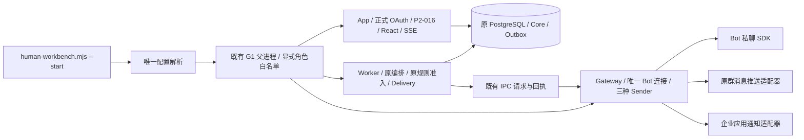

# 新版人工工作台运行入口

本入口显式选择 `WORKBENCH_RUNTIME_PROFILE=human-v1`，沿用 App、Worker、Gateway、PostgreSQL 和 P2-016 Runtime。未选择时 `--check` 返回 `enabled:false`，`--start` 拒绝启动。旧 P2-016/G1/G2/SS011 演练及 `_ENABLED` 限制保持。前向变更依照 [ADR-0034](../../adr/0034_mvp_notifications_and_application_members.md)，需显式执行 063 增量迁移；启动不自动迁移，不授予现场发送、部署或 Gate 批准。

2026-10-20 的 [ADR-0035](../../adr/0035_yixiaoxiu_h5_multimedia_and_member_service.md) 增加独立默认关闭的 H5 V2／多媒体选项。仅显式启用时要求 064／065；`human-v1` 本身不会自动打开新版 H5 或公开进度写入。

## 能力与实际装配

| 业务能力 | 本入口显式 Runtime 选项 | 必要依赖／角色 |
| --- | --- | --- |
| 接单、开始、分派、等待／恢复、完工、同单重开 | ticketSelfHandlingEnabled、ticketConversationSelfHandlingEnabled、ticketAssignmentEnabled、ticketWaitingActionsEnabled、ticketStaffCompletionEnabled、ticketReopenRoundsEnabled | App；原 Core／039／040／043 |
| 人工复核、明确结论并开始、人工代录 | workbenchManualReviewEnabled、workbenchReviewResolveAndStartEnabled、workbenchManualReportsEnabled | App；原复核／代录合同；手填联系人不自动获得应用发送资格 |
| 接管、转交、释放、私聊文字、内部备注 | workbenchConversationsEnabled、workbenchInternalNotesEnabled | App；真实 Session、原 Control／Communication／CSRF／个人授权 |
| 联系人收件箱、来源标签、个人已读、实时更新 | workbenchConversationInboxEnabled、sourceGroupDirectoryEnabled、workbenchPersonalReadEnabled、workbenchRealtimeEnabled | App；两个 conversation 选项同时为 true；identityHmacKey 映射现有身份密钥；唯一实时控制器 |
| 提交核对、补充跟进 | workbenchSupplementFollowUpEnabled | App；沿各原命令回执，不另建账本；当前页面保留未确认操作，核对后才允许下一次提交 |
| 节点通知、投递异常、受控恢复 | mvpNotificationsEnabled、ticketRoundNotificationsEnabled、notificationExceptionsEnabled | App 生成／消费原轮次通知意图，Worker 执行 Delivery，Gateway Sender；依赖接单、工作人员完工、模板、时间线、MEMBER_REQUIRED |
| 报修人查询、仍未解决 | MEMBER_REQUIRED、已证明的成员映射与 OAuth；yxxSelfService 的两个原 flags、reporterFeedbackEnabled；botReporterFeedbackEnabled | App；Web requestRef 与 Bot publicRef 分别原报修人验证；无 H5 映射的单独接收模式不装配自助／反馈 |
| 新版 H5、多媒体、催单／评价、管理端 Web 材料与催单提醒 | yxxH5.enabled；原成员 flags 保持；公开进度另需 workbenchProgressEnabled | 显式 H5 环境；App 的同源成员／工作人员双权限；Worker 的单并发转码与到期清理，064／065 |

只启用上述组合。H5 显式开启时挂载 Web 材料读取，并复用站内提醒消费本轮催单；不是原通道附件开关的放宽。原附件、核实目录候选、Incident、AI、关注、预约、活动、搜索、看板拖动、接管工单、撤派／退回等未列选项保持原默认值。H5 关闭时原提醒默认值保持。原动作仍按当前授权和状态决定是否可用。

首期 MVP 只面向信息科操作人员。2026-10-19 按用户决定，本入口的 `workbenchDraftRecoveryEnabled`、`botReporterFeedbackDraftRecoveryEnabled` 与 `yxxSelfService.reporterFeedbackDraftRecoveryEnabled` 均显式为 `false`。暂不提供跨刷新、离开页面后的草稿恢复。填写内容保留在当前页面。重复提交保护、授权校验、版本校验与提交结果核对继续生效。已有加密草稿、历史证据及其他测试配置保持，不执行批量清理；原未确认操作仍按既有保护只核对一次原操作。未来恢复此功能须单独验证动作变为可用时的初始化与跨刷新流程。

工单详情使用工单号、人员名称和中文业务状态。数据库标识、内部事件名、规则代码与版本信息不作为操作说明。文案采用短句、一句一事、同一动作使用同一名称的原则，参考 [ASD-STE100](https://www.asd-ste100.org/assets/files/ASD-STE100_ISSUE9.pdf)。这是中文界面的表达约定，不声明英文受控词典认证。接口、授权和审计原件继续保留原始标识与版本。



App 内 `gatewayEnabled/senderEnabled=false`，不是发信角色。原轮次消费者仍位于 App 的现有调度；受理编排和 Delivery Worker 在 Worker，保留 `composeConversationRuleAdmission`。群路由／提及使用 T26 适配器；H5 使用 T25 应用适配器；Bot 私聊使用原 Sender。发送前仍执行每种适配器原绑定、留存和等待后终检。

## 配置与角色

样例：[运行配置](../../config_examples/human-workbench.json)、[环境](../../config_examples/human-workbench.env.example)、[当前通知目标](../../config_examples/human-workbench-notification-bindings.json)。全部为占位符，直接运行会失败。真实文件放 `secrets/` 或其他受控目录，不提交。

| 名称 | 默认／要求 | 角色 |
| --- | --- | --- |
| WORKBENCH_RUNTIME_PROFILE | 未设置即关闭；仅接受 human-v1 | 父进程及三角色 |
| WORKBENCH_RUNTIME_CONFIG | 绝对 JSON 路径，版本1；未知字段／错误类型拒绝 | 仅父进程读取完整文件 |
| PILOT_DATABASE_URL | 必需；沿现有数据库权限 | 三角色 |
| PILOT_LOG_IDENTITY_HASH_KEY | 现有值，至少16字符；不轮换，不替换成 Reporter secret | App Runtime.identityHmacKey／认证、Worker 编排、Gateway 受理 |
| P2_016_REPORTER_HMAC_SECRET | 现有 Reporter 专用值，至少32字节，与身份密钥不同 | 三角色原 Reporter／通知／绑定用途 |
| APP_SECRET | 现有成员应用凭据；memberEntry 中复用已核对企业／应用／Bot 作用域 | App OAuth；Gateway 在发送或单独接收时使用；Worker 不接收 |
| WECOM_BOT_SECRET | transportEnabled=true 或 botInboundEnabled=true 时必需 | 仅 Gateway |
| WORKBENCH_EXTERNAL_IO_APPROVED／WORKBENCH_EXTERNAL_IO_APPROVAL_REF | 默认无；发送时需 true 和本次具名授权引用；配置本身不授予批准 | 父进程检查，Gateway 接收；不推进任何 Gate |
| WORKBENCH_INBOUND_IO_APPROVED／WORKBENCH_INBOUND_IO_APPROVAL_REF | 默认无；单独接收需 true 和本次接收授权引用，不代替发送批准 | 父进程检查，Gateway 成员核验 |
| settings.transportEnabled | false；true 同时启用 Gateway 与实际 Sender | 父进程、三角色；App 仍无进程内 Sender |
| settings.botInboundEnabled | false；true 可单独启用当前应用可见成员 Bot 接收，须本次接收授权引用 | 父进程、Gateway；不启用 Sender |
| settings.publicOrigin／reporterOrigin／listenPort | 必需；精确 HTTPS origin；后端 loopback 端口 1024–65535 | App；Reporter origin 供原卡片 Sender |
| settings.memberEntry | 新 H5 显式用 VERIFIED_APP_OPENID，无新成员名单；可选 reporterUserIds 只兼容原映射；旧 H5 可继续 VERIFIED_DELEGATED_MAPPING；单独 Bot 接收可用 UNVERIFIED、无 reporterUserIds，H5／反馈／App通知保持拒绝；不伪造 namespace 证明 | App 认证作用域、可选 H5／通知装配 |
| settings.bot | 原 Bot ID、WSS；历史 scope 每类1–20，单独成员接收时两类目标可为空 | Gateway；新接收不使用逐人／逐群名单 |
| settings.groupRoutes | 原 Bot／原群／官方 HTTPS Webhook，最多20，只需覆盖部分群；以 botId + groupId 精确对应，不能按群名路由 | 仅 Gateway 收到 URL；App 只收到 ID 对 |
| settings.appChannelAccountId | 原应用渠道账号，不能用 Bot 账号替代 | App／Gateway 通知用途 |
| settings.notificationBindingsFile | 绝对路径；既有映射／旧记录读取有界资格文件；新 H5 原生通知身份不依赖该文件，无 H5 的单独接收模式不读取 | App／Gateway 当前资格核对；Worker 不接收 |

通知目标文件是本入口消费的受控配置，不是业务表或身份系统。维护方必须提供当前 ACTIVE／VERIFIED／REACHABLE 的 InternalMemberId 资格及独立 Webhook 提及对应证明；OAuth 转换、旧报修快照、姓名或第三方目录标签不构成该资格。每次资格解析重读文件，删除目标／修改映射／到期立即拒绝新资格；不改投、不盲重发 UNKNOWN。文件整体映射摘要由已有 `yxxIdentityConfigHash(memberEntry)` 计算；既有成员配置原值和 proofRef 必须一致。更换已有身份密钥会改变既有身份，不能作为修复办法。

配置检查不连接数据库或 Provider；实际启动沿 Runtime schema readiness 拒绝缺少迁移。先用仓库已有 `migrate-current-baseline`／各工作包 migrate 的 check/status 核对，再在获得数据库授权时使用其 apply。所需扩展包括 063_mvp_notifications_app_members、workbench-auth、ticket-self-handling、staff-completion、round-notifications（包含052）、manual-reports、reopen-rounds、bot-feedback、personal-read、follow（既有回执依赖，关注功能仍关闭）、supplement-follow-up、source-groups、conversation-delivery-commands。启动命令不会补写迁移账本。

## MVP 通知切换

human-v1 显式启用 `mvpNotificationsEnabled=true`；通用 Runtime 默认 false。063 仅扩展原表，不删除字段、不改写 Message／Outbox、历史绑定或首责事件。执行当前编译候选的 `mvp:notifications:migrate:check`；数据库授权范围内再用 `mvp:notifications:migrate:apply`，重复应用校验 checksum 与结构。所有命令沿受控 PILOT_DATABASE_URL，不自动加载现场环境。

每轮 `FIRST_HANDLING` 取首次实际接单／开始事件，`STAFF_COMPLETED` 取工作人员完工事件。派单／转派／等待不发个人模板；群只在完工且存在原群 Webhook 时增加投递。Bot 群固定回应按[行为表](../../plans/mvp-notifications-h5/README.md)执行，取消旧群追问／范围／首报回执旁路。关闭新发送仍用原 transportEnabled 与 Worker 开关，保留历史和只读。

切换前暂停原 Sender 并读取在途状态：旧 FIRST_RESPONSIBILITY 与旧群规则消息的未尝试投递由现有 Worker 准入取消，保留审计；已发送和 UNKNOWN 保留原样。FIRST_HANDLING 遇到本轮旧个人通知未取消时不会重复创建。SENDING 先按原恢复合同核对，不能以升级为理由自动重发。降级先关写和发送；原默认 Worker 拒绝新增群回应，原字段和证据保留。

新模式的 proofRef、企业／应用范围、原通知账号和 Reporter HMAC 保持原值；保留可选旧映射和原资格文件，避免破坏旧记录身份。纯原生 H5 不执行启动名单转换，不同步目录。应用发送前用当前 OAuth namespace 再核验成员。Webhook 原生提及沿原 Bot 报修人身份；新模式启用成员准入时先核验原报修人的当前应用资格。

## 检查、启动、停止

### H5 V2 与多媒体显式启用

实际接口及 UNKNOWN 恢复见 [成员 H5 V2](../api/member/h5-v2.md)，工作人员四项读取／公开进度接口见 [Web 报修资料](../api/workbench/web-reports.md)。配置解析使用以下独立环境字段，不给 `WORKBENCH_RUNTIME_CONFIG` 的闭合 JSON 增加未知键；所有示例只列名称，不输出实际密钥或目录原值。

| 字段 | 默认／要求 | 角色边界 |
| --- | --- | --- |
| `YIXIAOXIU_H5_ENABLED` | 缺省 `false`；只接受字面量 `true`／`false` | 显式传入 App／Worker，Gateway 不接收 |
| `YIXIAOXIU_H5_PERFORMANCE_ENABLED` | 独立默认 `false`，H5关闭时不能单独true；开启前显式应用066预览迁移 | App最小页面引导／统计／补充分页、媒体HEAD／Range／THUMBNAIL及Worker预览；原V1/V2保持 |
| `YIXIAOXIU_H5_PREVIOUS_STATIC_ROOT` | 可选绝对路径，上一代已验证编译H5目录；H5关闭时不接受 | 仅回退登记的旧资源，不回退HTML、源码或设计原件 |
| `YIXIAOXIU_H5_PROGRESS_ENABLED` | 独立默认 `false`；H5 关闭时不能单独为 `true` | App 的当前处理人公开进度写入；READ、原用途回执与新 WRITE 分开 |
| `YIXIAOXIU_H5_PRIVATE_ROOT` | H5 开启时必需，绝对路径；预先准备的独立私有目录，不放在公开静态目录下 | App／Worker；构造器不自动创建根目录 |
| `YIXIAOXIU_H5_MEDIA_KEY_HEX` | H5 开启时必需，64 位十六进制，即 32 字节 AES 密钥；不复用身份／Reporter 密钥 | App／Worker，日志与浏览器不接收 |
| `YIXIAOXIU_H5_FFMPEG_PATH` | H5 开启时必需，显式绝对程序路径 | 仅 Worker，App／Gateway 不接收 |
| `YIXIAOXIU_H5_FFPROBE_PATH` | 与 FFmpeg 成对，显式绝对程序路径 | 仅 Worker；既有供应链／程序来源证据单独保留 |

父进程只按角色白名单转交字段。Worker 继续不持有 `APP_SECRET`、`memberEntry`、应用 token Provider 或新增外部发送资格；Gateway 不接收 H5 存储、加密密钥、转码程序或这些新开关。App 复用已有应用 token Provider 生成受控页面签名／下载临时素材，不向浏览器下发凭据，也不运行转码子进程。

M 的 `MEMBER_SELF_SERVICE` 扩展通过显式 `h5` 选项装配。F 即 `FULL_SERVICE_LOOP` 的 W 成员支路，human-v1 的 P2-016 App 将显式 `yxxH5` 构造成共享运行对象，再分别注入成员 handler 和工作人员 Web 材料／公开进度接口；沿原池和唯一 App 监听。只有 H5 开启才挂载相应支路，原 OAuth-only、成员只读与原成员写开关不被提升。

App 保存私有原件；Worker 在既有有限 `runOnce` 周期内串行处理，每轮最多一个播放副本任务，最多每 60 秒执行一次到期清理、每次最多 16 项。没有新增独立调度器、常驻媒体服务或数据库连接池。播放转换失败保留原件和已受理工单，返回明确的 `PENDING`／`UNAVAILABLE`；不能把未装配 FFmpeg 的 App 当作已经生成播放副本。

人员补全只复用已注入的 Directory Port 与 `localOnly` 当前成员资格；human-v1 没有因此新增人员 Provider 凭据、全员同步或外联默认值。缺少可靠映射、Provider 或当前资格时保持待补／`DEFERRED`，资料缺失不阻断受理。科室共享另外核验当前有效组织关系，不从相似 ID 或人员姓名推导。

启用前核对 [064 成员服务迁移](../../database/migrations/064_yixiaoxiu_h5_member_service.sql) 与 [065 Web 媒体迁移](../../database/migrations/065_yixiaoxiu_h5_web_media.sql) 的当前编译候选、checksum 和适用库。只有在具名数据库授权范围内才显式 apply；配置 `--check` 和 App／Worker 启动不会自动执行迁移 SQL，不得为通过 readiness 自动写迁移账本。H5 开启但迁移缺失时按 `yxx_h5_schema` 失败关闭。064／065 的本地合成应用不能改写旧迁移或视为现场批准。

材料未绑定保留最多 24 小时；绑定后不得超过原 Web Request／Submission／Intake 的最早截止。转码失败、停止或关闭新写不提前删除原件。到期 Worker 删除原件／副本的密文并记录清理状态，保留历史事实。停止时沿原父进程关闭顺序取消并等待 H5 流、私有存储和转码任务；不清空工单、UUID 回执或未到期材料。

只停公开进度写入时设置 `YIXIAOXIU_H5_PROGRESS_ENABLED=false`；只停成员新写沿原 `write_flag`／成员写开关，保留 H5 当前获权历史 READ 和原用途核对。`YIXIAOXIU_H5_ENABLED=false` 则退出新版页面／新路由，保留原 V1 读取、数据库和私有文件；它不是删除、回滚迁移或轮换密钥的命令。

只回退新增性能读取时设置`YIXIAOXIU_H5_PERFORMANCE_ENABLED=false`，保留H5和媒体原件读取；浏览器只对明确的`YXX_H5_ENTRY_DISABLED`回原读取。停止新预览生成后仍由原Worker到期清理已存在的预览，不能因回退延长材料留存。[性能读取合同](../api/member/h5-performance.md)记录每实例32MiB媒体缓冲、8项等待和60秒含排队截止；App与性能路径Worker合计受控媒体缓冲最多60MiB，并非跨进程共享32MiB，RSS及FFmpeg内存另行测量。实机效果与部署仍需独立验证及授权。

反向代理除原成员路径外，还须保留 `/wecom/yixiaoxiu/assets/` 的编译资源请求。服务只读取本次 Vite manifest 可达的同源 JS／CSS／字体／图片，拒绝设计稿、preview、manifest／inventory 和符号链接；原 Reporter 卡片仍走下文 `/reporter/` 资源路径。不得用公开私有存储目录或放宽 CSP 来修复缺失资源。

### Bot 接收与真实发送分开

[ADR-0033](../../adr/0033_bot_member_intake_without_manual_roster.md) 规定正式 Bot 报修使用企业微信当前应用可见成员准入，不逐人维护报修名单。显式设置 `botInboundEnabled=true` 并提供 `WORKBENCH_INBOUND_IO_APPROVED=true`、本次接收授权引用 `WORKBENCH_INBOUND_IO_APPROVAL_REF` 和既有 `WECOM_BOT_SECRET` 后，可单独接收私聊 Bot／群内 @Bot 消息。

收到消息后，服务使用回调中的发送者 userid 自动进行官方身份转换，并以该应用身份调用 `user/get` 核验当前权限和账号状态。查询在入库事务前完成；失败或无权限时拒绝。不会同步全院人员，不根据姓名或群成员列表授予权限，不自动授予 PC 角色。

仅接收时保持 `transportEnabled=false`；`bot.personTargetHashes`、`bot.groupTargetHashes` 和 `groupRoutes` 可为空数组。它们不作为新接收模式的人员、群白名单。通知与 Webhook 资格文件沿原发送合同，不因报修准入自动建立。`memberEntry.reporterUserIds` 只作为既有身份映射兼容；新 H5 成员准入不使用它，也不是 Bot 报修人名单。

不使用 H5 时，保留 `memberEntry.enabled=true` 和已核对企业／应用／Bot 作用域，设置 `identityMode=UNVERIFIED`、`memberIdsConfirmed=false`、`proofRef=null`、`proofKind=null` 并省略 `reporterUserIds`。此时不转换 H5 名单、不读取通知资格文件，不装配成员自助／反馈或 App通知；原 MEMBER_REQUIRED 读取继续拒绝未证明的跨身份访问，不回退旧 Grant。既有映射模式真实发送仍要求原已证明映射；新 H5 原生应用身份不借用 Bot userid。

成员查询按 1 个实际在途操作串行处理，最多保留 32 项。5 秒截止包含排队等待；超时且 Provider 未结束时仍保留占用，不能累积后台请求。无法核验、超时或队列满的本条消息不会进入业务库，也没有声称已自动重放；需在故障恢复后重新报修，不能把这一限制写成完整投递保障。

2026-10-21的[H5性能窄例外](../../adr/0036_yixiaoxiu_h5_performance_read_and_media_budgets.md)：APP中H5与性能开关都true时，合法entry专用当前成员核验最多2实际操作；与原BASE共用APP总2实际／32项，BASE仍最多1、Gateway／Bot和发送仍走原规则。5秒从入队起、底层未结束继续占槽、逐HTTP实际核验和等待后READ终检不变。该能力不启动额外服务或数据库池，默认关闭；性能验收结论以同编译身份的完整报告为准。

启动前确认目标 Bot 没有其他活动连接，保持一个 Gateway。`--check` 只报告配置，不启动连接或发消息。真实接收后按原 Inbox、Intake、规则、工单核心和工作台查看结果。Sender、投递 Worker 及 App 对外发送仍由 `transportEnabled` 控制。单独接收不代表消息回执、通知或报修人 H5 已验收。

### 执行编译入口

仓库根目录 PowerShell，先完成候选构建；以下入口均执行编译产物：

```powershell
npm.cmd run migration:build
node .build/tools/gate.mjs types
node .build/tools/verify-artifact.mjs
node --env-file=secrets/human-workbench.env .build/runtime/app/server/scripts/human-workbench.mjs --check
node --env-file=secrets/human-workbench.env .build/runtime/app/server/scripts/human-workbench.mjs --start
```

前台控制台输入 `stop` 再回车，或按 `Ctrl+C`。沿原父进程先停 Worker，再停 App／Gateway，关闭连接池；输出 `event:stopped,process_count:0`。父进程意外断开时角色退出。停止不删除工单、回执、草稿事实、待核对投递或历史证据。`transportEnabled=false` 同时关闭新外部发送入口与 Worker/Sender；已有需核对状态保留。正式 UI 为 `publicOrigin/workbench/app`，原工作台登录入口 `/workbench/login`，成员入口沿原 `/wecom/yixiaoxiu/`。

HTTPS 反向代理须转发到本机指定端口，保留原 Host/Origin、Cookie 和 SSE 长连接。本任务不部署代理。正式认证不返回测试 Cookie；原集群仅在显式 externalAuthentication 模式接受此拓扑，旧测试认证检查保持。

报修人页面即使位于 `/wecom/yixiaoxiu/tickets/`，仍使用 `/reporter/` 的绝对资源路径。部署代理时须同时转发 `/reporter/reporter.js`、`/reporter/reporter.css`、`/reporter/bot-feedback.js` 及 `/reporter/feedback-assets/`，不能只转发页面和 API。缺少脚本时，页面会停在“正在验证访问会话”。`/api/reporter/`、`/api/yixiaoxiu/` 和 `/wecom/yixiaoxiu/` 继续经过同一 App 的原成员认证，避免被更宽的代理规则截获。

部署验收须检查脚本、样式及其引用资源的真实 HTTP 200、正确内容类型和制品字节，再验证登录、进度读取及本人“仍未解决”反馈。页面文字出现不代表访问验证已完成。未认证的成员 API 仍须拒绝访问，健康检查和本地测试登录不得公开。代理日志不记录 OAuth 查询或卡片访问凭据。此处说明必要路由，不授予新的成员、发送或部署权限。

## 验证与交接

活动 selection 为 `v3-p09`；本任务相关集合 `human-workbench-wiring` 注册两个新入口。进程用例经过编译后的配置解析／父进程／三个角色入口，外部 HTTP/SDK 在专用测试子入口替换；无 runtimeFactory 替代，真实业务、数据库、OAuth Session、HTTP、React 和 Sender 保留。SYNTHETIC／ISOLATED_TEST 配置只能配显式外部测试边界和隔离 loopback 库，正式角色默认拒绝。

接线阶段的历史候选与原件见[接线交付记录](../../plans/admin-workbench-integration/execution/runtime-wiring.md)。当前候选已通过实际三进程的 A–F 隔离闭环，完整身份、定向测试原件、已修补的延迟会话绑定窗口、资源清理和真实试单清单见[隔离闭环验收](../../plans/admin-workbench-integration/execution/runtime-closure.md)。真实企业微信闭环仍为 NOT_RUN，本地合成验收不代表部署或正式启用。

H5 V2 的本地验证单独绑定本次源码／制品和原始输出，不把前述 A–F 的旧结果重记为新版验收。媒体、生命周期、HTTP、静态／制品、管理端消费及角色装配按本次注册选择执行；隔离数据库使用任务自有 loopback 合成库，Provider 和 SDK 明确使用模拟边界，记录失败、SKIP、NOT_RUN 与资源关闭结果，不调用真实企业 API 来补足自动化。

标记 `requires_ffmpeg:true` 的测试还要求显式环境 `H5_MEDIA_FFMPEG`、`H5_MEDIA_FFPROBE`，两者均为受控 FFmpeg／FFprobe 的绝对程序路径。测试路由仅在选中此类入口时前递这两个字段，缺少字段直接拒绝；不根据 PATH 猜测，也不沿用生产密钥或输出数据库连接值。这是测试宿主合同，与运行时 `YIXIAOXIU_H5_FFMPEG_PATH`／`YIXIAOXIU_H5_FFPROBE_PATH` 分开。CI 准备系统程序不证明本地测试已执行。企业微信 iOS／Android 的录音、相机、语言／主题和实际收件须独立现场授权与实机记录，未执行项保持 `NOT_RUN`。
