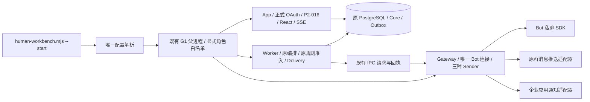

# 新版人工工作台运行入口

本入口显式选择 `WORKBENCH_RUNTIME_PROFILE=human-v1`，沿用 App、Worker、Gateway、PostgreSQL 和 P2-016 Runtime。未选择时 `--check` 返回 `enabled:false`，`--start` 拒绝启动。旧 P2-016/G1/G2/SS011 演练及 `_ENABLED` 限制保持。没有数据库／业务合同变更，没有自动迁移、现场发送、部署或 Gate 批准。

## 能力与实际装配

| 业务能力 | 本入口显式 Runtime 选项 | 必要依赖／角色 |
| --- | --- | --- |
| 接单、开始、分派、等待／恢复、完工、同单重开 | ticketSelfHandlingEnabled、ticketConversationSelfHandlingEnabled、ticketAssignmentEnabled、ticketWaitingActionsEnabled、ticketStaffCompletionEnabled、ticketReopenRoundsEnabled | App；原 Core／039／040／043 |
| 人工复核、明确结论并开始、人工代录 | workbenchManualReviewEnabled、workbenchReviewResolveAndStartEnabled、workbenchManualReportsEnabled | App；原复核／代录合同；手填联系人不自动获得应用发送资格 |
| 接管、转交、释放、私聊文字、内部备注 | workbenchConversationsEnabled、workbenchInternalNotesEnabled | App；真实 Session、原 Control／Communication／CSRF／个人授权 |
| 联系人收件箱、来源标签、个人已读、实时更新 | workbenchConversationInboxEnabled、sourceGroupDirectoryEnabled、workbenchPersonalReadEnabled、workbenchRealtimeEnabled | App；两个 conversation 选项同时为 true；identityHmacKey 映射现有身份密钥；唯一实时控制器 |
| 提交核对、补充跟进 | workbenchSupplementFollowUpEnabled | App；沿各原命令回执，不另建账本；当前页面保留未确认操作，核对后才允许下一次提交 |
| 节点通知、投递异常、受控恢复 | ticketRoundNotificationsEnabled、notificationExceptionsEnabled | App 生成／消费原轮次通知意图，Worker 执行 Delivery，Gateway Sender；依赖接单、工作人员完工、模板、时间线、MEMBER_REQUIRED |
| 报修人查询、仍未解决 | MEMBER_REQUIRED、成员入口、OAuth；yxxSelfService 的两个原 flags、reporterFeedbackEnabled；botReporterFeedbackEnabled | App；Web requestRef 与 Bot publicRef 分别原报修人验证，不通过管理员 reopen 代替 |

只启用上述组合。附件、核实目录候选、Incident、AI、提醒、关注、预约、活动、搜索、看板拖动、接管工单、撤派／退回等未列选项保持原默认值。原动作仍按当前授权和状态决定是否可用。

首期 MVP 只面向信息科操作人员。2026-10-19 按用户决定，本入口的 `workbenchDraftRecoveryEnabled`、`botReporterFeedbackDraftRecoveryEnabled` 与 `yxxSelfService.reporterFeedbackDraftRecoveryEnabled` 均显式为 `false`。暂不提供跨刷新、离开页面后的草稿恢复。填写内容保留在当前页面。重复提交保护、授权校验、版本校验与提交结果核对继续生效。已有加密草稿、历史证据及其他测试配置保持，不执行批量清理；原未确认操作仍按既有保护只核对一次原操作。未来恢复此功能须单独验证动作变为可用时的初始化与跨刷新流程。

工单详情使用工单号、人员名称和中文业务状态。数据库标识、内部事件名、规则代码与版本信息不作为操作说明。文案采用短句、一句一事、同一动作使用同一名称的原则，参考 [ASD-STE100](https://www.asd-ste100.org/assets/files/ASD-STE100_ISSUE9.pdf)。这是中文界面的表达约定，不声明英文受控词典认证。接口、授权和审计原件继续保留原始标识与版本。



App 内 `gatewayEnabled/senderEnabled=false`，不是发信角色。原轮次消费者仍位于 App 的现有调度；受理编排和 Delivery Worker 在 Worker，保留 `composeConversationRuleAdmission`。群路由／提及使用 T26 适配器；H5 使用 T25 应用适配器；Bot 私聊使用原 Sender。发送前仍执行每种适配器原绑定、留存和等待后终检。

## 配置与角色

样例：[运行配置](../../config_examples/human-workbench.json)、[环境](../../config_examples/human-workbench.env.example)、[当前通知目标](../../config_examples/human-workbench-notification-bindings.json)。全部为占位符，直接运行会失败。真实文件放 `secrets/` 或其他受控目录，不提交。

| 名称 | 默认／要求 | 角色 |
| --- | --- | --- |
| WORKBENCH_RUNTIME_PROFILE | 未设置即关闭；仅接受 human-v1 | 父进程及三角色 |
| WORKBENCH_RUNTIME_CONFIG | 绝对 JSON 路径，版本1；未知字段／错误类型拒绝 | 仅父进程读取完整文件 |
| PILOT_DATABASE_URL | 必需；沿现有数据库权限 | 三角色 |
| PILOT_LOG_IDENTITY_HASH_KEY | 现有值，至少16字符；不轮换，不替换成 Reporter secret | App Runtime.identityHmacKey／认证、Worker 编排、Gateway 受理 |
| P2_016_REPORTER_HMAC_SECRET | 现有 Reporter 专用值，至少32字节，与身份密钥不同 | 三角色原 Reporter／通知／绑定用途 |
| APP_SECRET | 现有成员应用凭据；memberEntry 中复用已有企业／应用／Bot／namespace 证明 | App OAuth；启用发送时 Gateway 应用 Sender；Worker 不接收 |
| WECOM_BOT_SECRET | transportEnabled=true 时必需 | 仅 Gateway |
| WORKBENCH_EXTERNAL_IO_APPROVED／WORKBENCH_EXTERNAL_IO_APPROVAL_REF | 默认无；发送时需 true 和本次具名授权引用；配置本身不授予批准 | 父进程检查，Gateway 接收；不推进任何 Gate |
| settings.transportEnabled | false；true 同时启用 Gateway 与实际 Sender | 父进程、三角色；App 仍无进程内 Sender |
| settings.publicOrigin／reporterOrigin／listenPort | 必需；精确 HTTPS origin；后端 loopback 端口 1024–65535 | App；Reporter origin 供原卡片 Sender |
| settings.memberEntry | 复用已有 VERIFIED_DELEGATED_MAPPING 及原 reporterUserIds；现有 H5 自助／反馈合同要求委托映射，不能用 SAME_NAMESPACE 代替；OAuth/MEMBER_REQUIRED 同时装配；正式发送只接受 LIVE／DEPLOYMENT | App 认证、各通知目标校验 |
| settings.bot | 原 Bot ID、WSS、原个人／群目标 SHA256；沿既有 scope 每类1–20 | Gateway；原目标白名单 |
| settings.groupRoutes | 原 Bot／原群／官方 HTTPS Webhook，最多20，与群 scope 精确对应 | 仅 Gateway 收到 URL |
| settings.appChannelAccountId | 原应用渠道账号，不能用 Bot 账号替代 | App／Gateway 通知用途 |
| settings.notificationBindingsFile | 有界绝对文件；归属相同 member 配置的当前验证证明与有效期 | App／Gateway 当前资格核对；Worker 不接收 |

通知目标文件是本入口消费的受控配置，不是业务表或身份系统。维护方必须提供当前 ACTIVE／VERIFIED／REACHABLE 的 InternalMemberId 资格及独立 Webhook 提及对应证明；OAuth 转换、旧报修快照、姓名或第三方目录标签不构成该资格。每次资格解析重读文件，删除目标／修改映射／到期立即拒绝新资格；不改投、不盲重发 UNKNOWN。文件整体映射摘要由已有 `yxxIdentityConfigHash(memberEntry)` 计算；既有成员配置原值和 proofRef 必须一致。更换已有身份密钥会改变既有身份，不能作为修复办法。

配置检查不连接数据库或 Provider；实际启动沿 Runtime schema readiness 拒绝缺少迁移。先用仓库已有 `migrate-current-baseline`／各工作包 migrate 的 check/status 核对，再在获得数据库授权时使用其 apply。所需扩展包括 workbench-auth、ticket-self-handling、staff-completion、round-notifications（包含052）、manual-reports、reopen-rounds、bot-feedback、personal-read、follow（既有回执依赖，关注功能仍关闭）、supplement-follow-up、source-groups、conversation-delivery-commands。启动命令不会补写迁移账本。

## 检查、启动、停止

### Bot 接收与真实发送分开

[ADR-0033](../../adr/0033_bot_member_intake_without_manual_roster.md) 规定正式 Bot 报修使用企业微信当前应用可见成员准入，不逐人维护报修名单。显式设置 `botInboundEnabled=true` 并提供 `WORKBENCH_INBOUND_IO_APPROVED=true`、本次接收授权引用 `WORKBENCH_INBOUND_IO_APPROVAL_REF` 和既有 `WECOM_BOT_SECRET` 后，可单独接收私聊 Bot／群内 @Bot 消息。

收到消息后，服务使用回调中的发送者 userid 自动进行官方身份转换，并以该应用身份调用 `user/get` 核验当前权限和账号状态。查询在入库事务前完成；失败或无权限时拒绝。不会同步全院人员，不根据姓名或群成员列表授予权限，不自动授予 PC 角色。

仅接收时保持 `transportEnabled=false`；`bot.personTargetHashes`、`bot.groupTargetHashes` 和 `groupRoutes` 可为空数组。它们不作为新接收模式的人员、群白名单。通知与 Webhook 资格文件沿原发送合同，不因报修准入自动建立。`memberEntry.reporterUserIds` 仍只属于原 H5 OAuth 映射，不是 Bot 报修人名单。

启动前确认目标 Bot 没有其他活动连接，保持一个 Gateway。`--check` 只报告配置，不启动连接或发消息。真实接收后按原 Inbox、Intake、规则、工单核心和工作台查看结果。Sender、投递 Worker 及 App 对外发送仍由 `transportEnabled` 控制。单独接收不代表消息回执、通知或报修人 H5 已验收。

### 执行编译入口

仓库根目录 PowerShell，先完成候选构建；以下入口均执行编译产物：

```powershell
npm.cmd run migration:build
node .build/tools/gate.mjs types
node .build/tools/verify-artifact.mjs
node --env-file=secrets/human-workbench.env .build/runtime/scripts/human-workbench.mjs --check
node --env-file=secrets/human-workbench.env .build/runtime/scripts/human-workbench.mjs --start
```

前台控制台输入 `stop` 再回车，或按 `Ctrl+C`。沿原父进程先停 Worker，再停 App／Gateway，关闭连接池；输出 `event:stopped,process_count:0`。父进程意外断开时角色退出。停止不删除工单、回执、草稿事实、待核对投递或历史证据。`transportEnabled=false` 同时关闭新外部发送入口与 Worker/Sender；已有需核对状态保留。正式 UI 为 `publicOrigin/workbench/app`，原工作台登录入口 `/workbench/login`，成员入口沿原 `/wecom/yixiaoxiu/`。

HTTPS 反向代理须转发到本机指定端口，保留原 Host/Origin、Cookie 和 SSE 长连接。本任务不部署代理。正式认证不返回测试 Cookie；原集群仅在显式 externalAuthentication 模式接受此拓扑，旧测试认证检查保持。

## 验证与交接

活动 selection 为 `v3-p09`；本任务相关集合 `human-workbench-wiring` 注册两个新入口。进程用例经过编译后的配置解析／父进程／三个角色入口，外部 HTTP/SDK 在专用测试子入口替换；无 runtimeFactory 替代，真实业务、数据库、OAuth Session、HTTP、React 和 Sender 保留。SYNTHETIC／ISOLATED_TEST 配置只能配显式外部测试边界和隔离 loopback 库，正式角色默认拒绝。

接线阶段的历史候选与原件见[接线交付记录](../../plans/admin-workbench-integration/execution/runtime-wiring.md)。当前候选已通过实际三进程的 A–F 隔离闭环，完整身份、定向测试原件、已修补的延迟会话绑定窗口、资源清理和真实试单清单见[隔离闭环验收](../../plans/admin-workbench-integration/execution/runtime-closure.md)。真实企业微信闭环仍为 NOT_RUN，本地合成验收不代表部署或正式启用。
