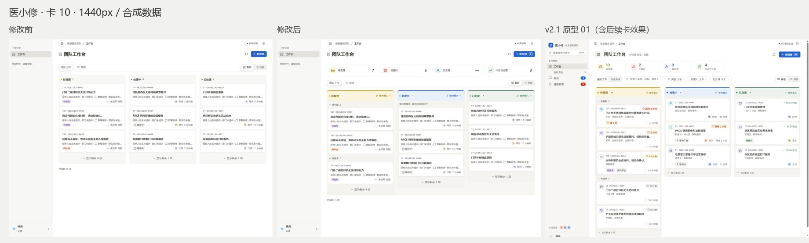

# PC 管理端 v2.1 · 卡 10 看板骨架

本卡对应 [v2.1 方案](design-system-v2.1.md) §3.1、§4.1、[设计系统](design-system.md) §6.6 与原型 01。基线为已合并卡 9 的 `main@f1b7592e893b2aebc70a185cd82c28a9870a4bb1`（PR #129）。本次用户明确授权本地实施、提交/推送、PR、`@codex review` 修复循环、merge commit、main 快进及本次自有资源清理；卡 11–16 未启动。

2026-11-02 补充授权：CI 暴露既有复核事务死锁后，用户明确选择「授权最小后端修复」，允许本 PR 例外附带取锁顺序、等待后权限/材料终检及确定性回归。该例外不实施卡 11，不新增接口/状态/路由/投递事实；具体范围与证据见文末。

## 改动与文件

| 路径 | 责任 |
| --- | --- |
| `app/pc-admin/src/design/components/BoardColumn/BoardColumn.tsx`、`board-column.css` | 3px 阶段色带、浅色列头、阶段圆点、半透明白色计数、排序菜单、可折叠受理分组 |
| `app/pc-admin/src/design/components/BoardColumn/workbench-board.css` | `--bg-board` 暖灰看板底；列体使用 `--bg-column` |
| `app/pc-admin/src/design/components/BoardSummary/BoardSummary.tsx`、`board-summary.css` | 标题下四个统计筛选；选中蓝描边、tooltip、统计数字的可访问名称、加载/不可用/部分失败提示、窄屏两列 |
| `app/pc-admin/src/design/board-presentation.ts` | 只读前端筛选与排序；共用 heat.ts 的四小时边界；显式北京时间 |
| `app/pc-admin/src/app/Workbench.tsx` | 接入统计、分组、排序；保留每列默认三项/展开/分页；SSE 抽屉冻结实际展示顺序，只存事项键 |
| `app/pc-admin/src/design/status-map.ts` | 移除卡片重复的「待判断」展示标签，状态值和复核提示不变 |
| `app/pc-admin/src/design/tokens.css` | 增加半透明计数语义 Token `--bg-stage-count`，HeroUI 桥接不变 |
| `app/pc-admin/src/features/manual-report/ManualReportForm.tsx`、`design/components/Button/button.css` | 原获权「新报修」primary 内增加 N 提示，不改许可或导航命令 |
| `tests/pc-admin-design-foundation.test.mts` | 增加四小时边界、处理中不推算、本人 HANDLING、北京时间跨日及不可变排序检查 |
| `tests/web01-workbench.browser.test.mjs` | 新增概况/折叠/排序/键盘/无写请求与 SSE 冻结回归；一条旧视觉断言更新为本卡获准的列底色 |
| `tests/wbint-t17-manual-form.browser.test.mts`、`tests/wbint-t18-normal-verified-form.browser.test.mts` | 返回看板后通过原列尾按钮展开新卡；两份原测试的 38 / 70 条 assert 调用逐字保留 |
| `app/server/src/p2-016-manual-review-facade.mts`、`tests/wbint-t14-review-boundaries.integration.test.mts`、`docs/api/workbench/manual-reviews.md` | 用户追加授权的最小后端锁顺序修补、确定性 FK/流锁回归及等待后失权拒绝 |
| `docs/ui/design-system.md`、`design-system-v2.1.md`、本文与 `evidence/v21-card10/compare-*.jpg` | 规范先行、确认口径、交付与四宽证据 |

卡 10 视觉部分无后端改动；本 PR 另含上述追加授权的后端锁顺序及等待后终检修复。无数据库/接口/业务命令字段、Ticket 状态值、责任路由、请求参数、依赖、默认 Feature Flag 或部署变更。统计不新建责任事实；服务目录与类别映射没有改动。

## 已确认的补充与过渡口径

2026-11-02 用户确认：

- 排序提供「等待最久」（默认）/「最新到达」，只排列已加载项。待受理取 created_at，已处理取 completed_at；缺少完成时间的事项排末尾。处理中在卡 11 前保留服务器顺序，并显示等待时间尚未补齐，不用 updated_at 推算。
- 「已超时」暂只统计待受理中 created_at 满 heat.ts danger 阈值的 Ticket，tooltip 明示处理中暂未计入。
- 「我负责」只消费 caller-only attention.related_reasons 的 HANDLING；不拿显示姓名、关注或会话接待责任替代。无投影时显示「—」并禁用筛选。
- 「今日已处理」按北京时间 completed_at，与当前已加载查询/日期范围一致。四卡均提示「基于已加载的 N 项」；再次点击取消，同时影响看板与列表，不改变原分页查询。

N 本卡只显示提示，实际快捷键绑定由卡 16 统一实施。卡片资料收纳、类别瓷砖、热度、领取与完整下一步操作分别留给后续卡。

## 验证

原始检查、失败、截图和资源回执位于 `D:/CodexEvidence/pc-admin-v21-card10-20261102`。首候选本地构建绑定基线上的未提交工作区，输入指纹 `732ac2fff4244dcbab1eee1cf1dd1afe73d748f80cf52d05ca9c80be21e9deb1`，manifest SHA-256 `d0cfe464d23103a2b82f7ef6a68636537dcde6acae91ce97e39c14b556706129`，随后提交为 `b3b7e2edac7d7cc29b27cb2b84651094098995eb`。下表为该首候选结果；后继审查修补见文末。提交后完整 head 由普通 PR CI 独立验证；不把 dirty 工作区结果重绑为 merge commit 的新运行。

| 检查 | 结果 |
| --- | --- |
| `npm run migration:build` | PASS；912 strict 模块、912 实际 Node 语法检查、2741 输出 |
| `node .build/tools/gate.mjs types` | PASS；完整 strict、负向类型、CSS、变量与 feature 语法门禁 |
| `node .build/tools/verify-artifact.mjs` | `ARTIFACT_VERIFIED_NOT_ACTIVATED` |
| 相关注册测试 | 35/35 PASS，0 FAIL / SKIP / NOT_RUN；活动 v3-p09 的 foundation 19 + WEB01 12，另加 T42 authority-navigation 3 / legal-action 1 两个相关注册入口，不称活动全集 |
| Stylelint / ESLint | 0 / 0；变量检查无未定义或原始色板泄漏 |
| 指令文档 / 工具回归 | PASS / 21 tests PASS（设计系统 2、指令文档 19；相关工具未改） |
| 设计检测 | 1 条可解释 warning：任务明确要求的列头 3px 阶段色带；未新增 lint 例外 |
| 四宽采图 | 最终 before / after 各四档均完成三列加载、9 张默认卡、1 个获权 primary、页面溢出 0；采图 POST=0 |

浏览器通过真实 loopback HTTP、任务自有 PG18 合成库与正式 bundle；纯函数检查转译实际 browser TS 源码，不称后端运行制品。开发阶段两项专用交互检查也通过，但不替代最终注册运行。

## 四宽前后与原型

每张图从左到右为修改前 / 修改后 / 原型 01。原型含卡 12 及以后的效果，未把这些内容记为本卡完成。900px 保留既有看板内部横向滚动；四档均无页面级溢出。

| 宽度 | 前后与原型 | 首屏彩色像素估算：前 → 后 |
| ---: | --- | ---: |
| 1920 | [并排图](evidence/v21-card10/compare-1920.jpg) | 0.30% → 4.04% |
| 1440 | [并排图](evidence/v21-card10/compare-1440.jpg) | 0.40% → 4.50% |
| 1280 | [并排图](evidence/v21-card10/compare-1280.jpg) | 0.45% → 4.47% |
| 900 | [并排图](evidence/v21-card10/compare-900.jpg) | 0.61% → 5.61% |

估算按非中性阶段/tone/品牌 Token 调色板逐像素匹配（RGB 各通道容差 1），分母为含留白的完整 1080px 高视口，排除暖灰背景；抗锯齿和头像可带来小幅误差。**未达到整体 8–12% 目标**，不通过扩大无语义色块凑数。卡 12 接入类别与热度后需重新估算；当前图只证明本卡骨架。

## 自检

| 自检 | 是 / 否 + 证据 |
| --- | --- |
| 前端未改业务命令、状态值、权限判断 | 是（卡 10 视觉部分）。原 ManualReportEntry 与 BoardActions 沿用；本 PR 另有用户追加授权的后台取锁/等待后终检例外，不宣称整个 PR 仅有前端差异 |
| 测试选择器只增不删；改过的测试只改文案期望 | 否（“只改文案”这一项）。原 class/data 选择器保留；新增统计与组选择器和回归。按本卡要求同步更新一条旧列底色视觉期望，既有状态/权限/请求/回执/次数等业务断言原样，未放宽 |
| 新增颜色经 Token，Stylelint / ESLint 为 0 | 是。阶段/tone 复用卡 9，计数半透明值在 tokens.css；0 / 0 |
| 新增彩色对应阶段 / 紧急 / 类别 / 人 | 是。列头=阶段、超时=紧急、本人负责=人；既有品牌操作/选中语义保留，无装饰性新增色 |
| 卡片没有「未提供 / 未登记」 | 否。资料收纳属卡 12，本卡保留原卡片元信息，不提前改资料行为 |
| 有权限时每区域恰好一个 primary | 是（本卡页面）。四档获权夹具均为 1 个「新报修」；只读场景无此按钮。抽屉/会话完整主操作收口仍属卡 13/14 |
| 热度阈值来自 heat.ts，无组件硬编码阈值 | 是。超时筛选直接调用 heatOf；四小时边界与 1 秒内侧均有直接检查 |
| 四宽与原型并排核对 | 是。四张最终并排图、18 张原始 PNG 及 SHA-256 manifest；最终图均等三列完成 |

## 原失败与未运行

- 初次构建：新增 Node 测试错误地从无扩展名 browser client 导入类型，TS2835 拒绝；改为读取既有 contracts 类型，保留失败日志。
- 合成夹具同时开启代录与关注时触发既有 `P2_012_SCHEMA_DRIFT`；不修改历史迁移或业务代码掩盖。代录与关注分别验证，正式截图使用代录场景；本人关系使用独立关注场景。
- 首次注册脚本把两个 T42 入口误认为活动 selection 成员而拒绝，未运行；修为明确的相关注册附加范围，不扩写活动 selection。
- 首轮实际注册结果为 28 PASS / 2 FAIL：新增用例发现 aria-description 未落到实际按钮，另一条旧视觉断言仍期待 v2.0 列底。改为实际 title/tooltip 与含数字的可访问名称，视觉期望同步本卡指定 Token，业务断言未变。
- 第二轮实际注册为 29 PASS / 1 FAIL：新增排序预期未处理 null completed_at，错误地把未确认完成时间排最前；新增测试预期更正，生产纯函数原有 null 排末尾行为不改。两轮 T42 均因前入口失败为 NOT_RUN，最终单独执行。
- 布局检查同时修正选中卡悬停丢描边、待判断占满三项名额、打开 SSE 抽屉恢复服务器顺序的问题；前后均只持有当前获权 DTO。
- 首轮采图曾捕到未完成加载的中间态；原图保留，最终 before/after 全四档重新等待三列完成。构建清理运行树期间一次采图因模块尚未生成而未运行，日志保留，不当成截图成功。
- 构建保留既有 chunk 超过 500 kB 提示。手动 full/certify、Electron、真实发送、现场业务、生产部署与 Gate 均 NOT_RUN。

## 资源、回退与下一卡

唯一源码/Git/runtime 写者为当前会话；布局子任务只读。自有 PG18 只监听 `127.0.0.1:58450`，max_connections=8，fixture 创建全新 UUID 合成库并沿 finally 清理；浏览器、profile、HTTP 宿主与 SQL 连接按原测试合同关闭。停止前只余 postgres/template0/template1，其他客户端 0；停止后 pg_ctl status=3、监听 0。已按绝对路径白名单与无重解析点检查删除自有 pgdata、before-bundle、development-bundle；回执为仓库外 cleanup-local.json。采图浏览器 processes/profiles/commandTimers/sockets 全为 0，注册测试按原资源合同通过清理核验。用户原型、历史 Evidence、失败、NOT_RUN、原始截图、恢复引用、共享 `.build` 和依赖保留。

回退为 revert 本 PR；无数据库回滚，无新持久开关。Backlog：卡 10 本地实施与验证完成，授权发布、远端 CI/审查、合并与 Git 清理沿 PR 及最终交付读回。GitHub 未发现对应卡 10 的既存 Issue，不修改无关 Issue。卡 11 可以按其独立只读投影任务执行，但本次未授权实施；卡 12/13 仍被卡 11 的 service / stage_entered_at 投影阻塞。

## PR #130 首轮 P2：展示排序与抽屉导航一致

机器人在发布 `b3b7e2edac7d7cc29b27cb2b84651094098995eb` 上发现 [P2](https://github.com/peterkis/Fault-Reporting-WeCom-Assistant/pull/130#discussion_r4438272700)：列内排序与冻结由子组件拥有，Detail 仍收到服务器顺序。因此中间卡的「下一项」会反向跳转。加强目标断言后，在原正式 bundle 上 SSE 关闭/开启两例均 RED，原件为 `review-navigation-red.log`。

修补将三列排序状态上提到 Workbench，由同一个按阶段、受理分组、列排序及概况筛选后的已加载集合供卡片、列表与 Detail 导航使用；SSE 冻结同一集合的事项键，切换抽屉目标不重置冻结，任何 DTO 仍来自当前获权 GET。BoardSection 只负责分组折叠和前三项预算，不再私藏排序。无请求、权限、业务命令或回执变更。

新回归在 SSE 关闭/开启两种装配下均核对：已处理列中间项 → 下方精确 ID → 原中间精确 ID；概况筛选后的待判断 → 待接单跨组精确 ID；冻结期间背景卡片顺序保持。开发验证 3/3 PASS；后继实际构建、strict types、artifact 全部 PASS，相关注册 36/36 PASS（foundation 19 + WEB01 13 + T42 4，0 FAIL/SKIP/NOT_RUN），Stylelint/ESLint 0/0。

后继本地结果绑定 `b3b7e2edac7d7cc29b27cb2b84651094098995eb` 上未提交工作区，输入指纹 `e293894533428b02f362af7d9852b32bd94699cd75049f0209dfbfe6b262c368`、manifest SHA-256 `b0c77fc4eb2ab40f3ccffe0243ffdb3de85b6fda17698f1b34a642efdfb6bfc8`；原件为 `build-review`、`types-review`、`artifact-review` 与 `registered-tests-review`。工具与文档检查沿未改实现，不重复工具回归。复验使用独立自有 pgdata-review；停止前仅余三默认库、其他客户端 0，停止后 status=3、监听 0，按绝对路径/无重解析点检查删除该合成集群及开发 bundle，回执为 cleanup-review.json。

后继没有 CSS、Token 或 DOM 结构变更，不重复四宽视觉采样；上面的最终四宽图及色彩估算绑定首候选外观，后继验证专注于导航目标和冻结语义。远端结果与完整发布 head 沿 PR 读回，不重绑原 35/35 运行。

## CI 折叠前提修补

第二轮对 `c84da43822f92063608edb2b17a475edea9cf7cc` 的 Codex 审查 completed、has_any_findings=false、has_unresolved_findings=false；首轮 P2 线程已解决。该 head 与先前 `b3b7e2ed…` 的普通 CI 分别在 [41375125905](https://github.com/peterkis/Fault-Reporting-WeCom-Assistant/actions/runs/41375125905) / [41374152962](https://github.com/peterkis/Fault-Reporting-WeCom-Assistant/actions/runs/41374152962) 停于 T18 返回看板等待新受理卡片，两个 FAIL 原日志均保留。

实际 POST 已为 202，原受理状态/身份/回执断言都通过；超时点是默认「等待最久」和列内三项预算使新受理位于折叠内容。当前正式 bundle 的原 T18 在本地同样 RED。只增加通过已有 `clickWorkbenchControl` 点击原待受理列展开按钮的步骤，原卡片等待、原 Review 读取与资料断言继续执行；同类 T17 电话代录返回路径同步适配。没有生产源码改动，不改变三项预算、排序、请求、权限或任何业务断言。

两用例在修补候选中分别 PASS；T17 的 38 条、T18 的 70 条 assert AST 调用文本与 `c84da438…` 逐字相同，核对回执为 `test-assertions-preserved.json`。最终相关检查为 6 个注册入口、38/38 PASS，0 FAIL/SKIP/NOT_RUN；build、strict types、artifact 均 PASS。样式及工具实现未改，Stylelint/ESLint 0/0 和工具 21/21 的适用范围保持。

最终本地候选绑定 `c84da43822f92063608edb2b17a475edea9cf7cc` 上未提交工作区，输入指纹 `d158a6e74f73b0ae3da3007b663e73a0cd4ed22e822ae761d6b007f7e8b48028`、manifest SHA-256 `537d9211fe9a1ecc1574da26eaf440683e7211fef62e12949e8cf93a35104767`；原件为 `build-ci-fix`、`types-ci-fix`、`artifact-ci-fix`、`registered-tests-ci-fix`，不重绑前一候选的 36/36。第三轮自有 pgdata-ci 清理前只余默认三库、其他客户端 0；停止后 status=3、监听 0，验证绝对路径和无重解析点后删除集群，回执 cleanup-ci.json。最终发布 head 的远端审查及 CI 沿 PR 读回。

## 追加授权：复核回执外键与实时流锁

`27a229d8c1480568e86ae78112dd86fa5cfd484f` 第三轮审查 completed、无发现；普通 CI [41376373237](https://github.com/peterkis/Fault-Reporting-WeCom-Assistant/actions/runs/41376373237) 越过代录后，在原 T14 并发用例得到 `[200,503]` 而非 `[200,409]`。PostgreSQL 原日志明确记录 Review 行锁与 `P2_003_REALTIME_STREAM:CONVERSATION_WORKBENCH` advisory lock 的死锁环，日志保存在 ci-third-head-failure.log。原后端/原 T14 用例在本 PR 此前均未改；本地原样 3/3 PASS 只是一次未复现，不记为修复。

用户明确授权本 PR 最小后端例外后，增加两个有界、无后台 Worker 的真实 PG/HTTP 回归：外部事务先持有现有流锁，观察两个 HTTP 命令真实进入 pg_locks 等待，要求它们此时尚未持有 Review 回执外键的 RowShare 锁；释放后仍恰好一个成功、一个 409、仅一个人工决议/Ticket/Event、无通信或通知增加。第二例在真实流锁等待期间撤销当前主体，要求原命令拒绝且无回执/业务事实新增。观察基于实际锁状态，不依靠固定 sleep 猜测时序。

两个新用例对原正式后端均 RED（2 个前置 Review FK 锁、等待期间失权仍可继续），原件为 t14-lock-order-red.log。修补只在原 authorizeResolution 中将实时流锁移到 ledger 回执外键之前，并在等待后重新读取原权限/材料；沿现有 Ticket 命令的取锁顺序，不改命令形状、事实源或状态机。

后继完整 build、strict types、artifact PASS；12 个相关注册入口 **61/61 PASS**，0 FAIL/SKIP/NOT_RUN。其中 T14 边界 5 项包含两个新 GREEN，其它范围覆盖原人工结论与安全动作、T14 材料/回执、T15 原子性/回执/等待中 Web 到期，以及原卡 10 相关 38 项，不称活动全集或 full/certify。结果绑定 `27a229d8c1480568e86ae78112dd86fa5cfd484f` 上的未提交工作区，输入指纹 `327d69913c11ae5c1450ad5ac115ceac03a87bafc22f86914a11f8d69d991e5b`、manifest SHA-256 `c82f24b5c7a14b2c0e161f5e60723ef1627e4dd9d49c3686a09cad3a701554f1`；原件为 build-lock-fix / types-lock-fix / artifact-lock-fix / registered-tests-lock-fix，不重绑上一候选的 38/38。

第四轮自有 pgdata-diagnostic 停止前仍只有三默认库、其他客户端 0；停止后 status=3、监听 0，核验绝对路径与无重解析点后删除合成集群，回执 cleanup-diagnostic.json。原 CI 死锁、自然未复现、确定性 RED 与最终 GREEN 分开保留。最终发布 head 的远端审查/CI 仍须独立通过后才合并，不因本地修补推进现场、部署或 Gate。
