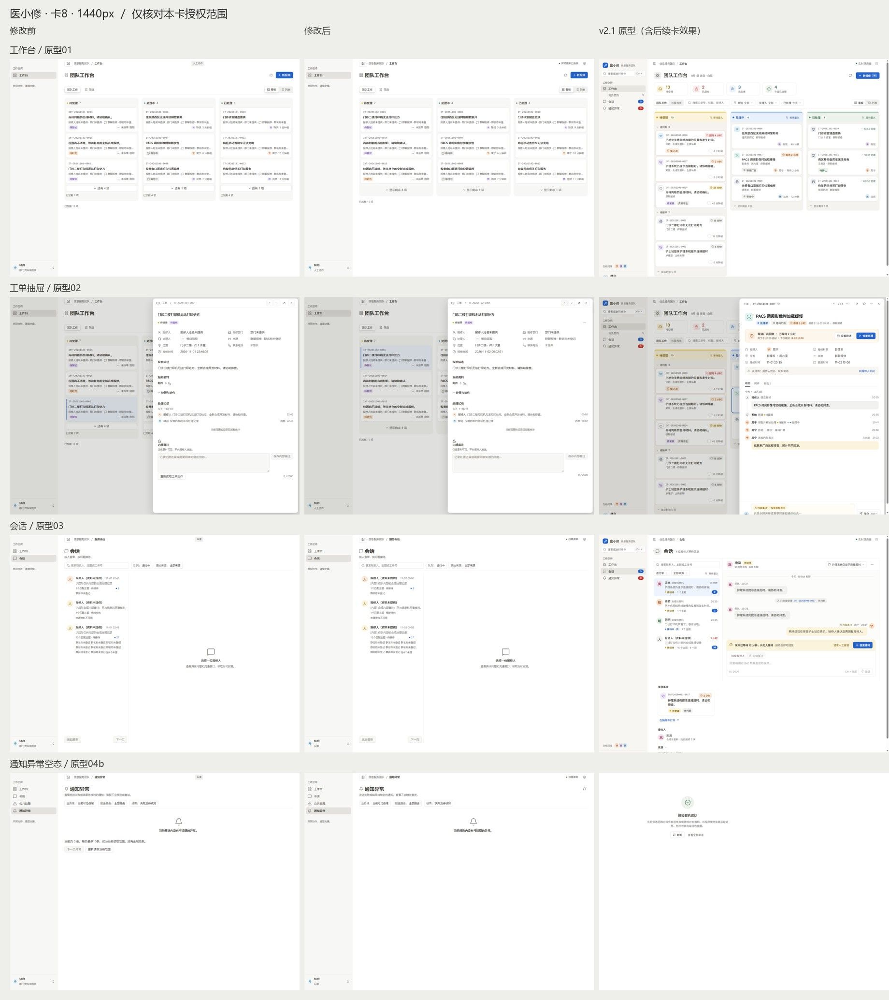

# PC 管理端 v2.1 · 卡 8 收尾

本卡依据 [v2.1 方案](design-system-v2.1.md) §4.1（列尾）、§4.2（刷新可用操作）、§4.4（通知异常）与 §4.5（全局），参考原型 01 / 02 / 03 / 04b。只实施卡 8，不提前实施卡 9–16。

## 改动与边界

- 「人工协作 / 只读」沿用原四项能力展示判定，移到左下账号姓名下；部门有值时显示「部门 · 角色」，资料缺失时只显示角色，不伪造「信息科」事实。桌面右上保留原连接状态的文字与设置；900px 下由原账号菜单的设置图标承接设置和退出。
- 四页复用同一 Shell 面包屑与 PageHeader；新报修的面包屑补为「新报修」。工作台面包屑在当前基线已存在，核验保留。
- 列尾把「还有 N 项」及可见的已加载计数合为 ghost「显示剩余 N 项 / 收起」，已加载计数放 tooltip。保留原 3 项折叠规则、已加载范围限定、整板已加载提示和服务端加载下一页。
- 通知异常无数据时隐藏分页说明与下一页按钮；原刷新流程移到标题右侧图标，原 `data-action=reload-exceptions` 保留。副标题采用指定文案。
- 备注刷新按钮移到原「⋯」并改名「刷新可用操作」。Portal 只移动 DOM 展示，原备注控制器、阻塞分支、回执与失权清理不变；保留原 class 祖先选择器。工单通用空态改为「这里暂时没有工单」，已处理的具体日期范围提示不变。「可见的联系人」在基线已采用，核验保留。
- `border-radius: var(--radius-sm) 0 0 var(--radius-sm)` 在基线源码已正确，无重复修补；新增 `--fs-avatar-sm` 的文档说明，不新增正文字号。

无数据库、后端、业务命令、状态值、权限判断、请求参数、默认 Feature Flag、依赖、发送或部署变更。连接展示使用原 `realtimeLabels`，不新增轮询或连接，不将实时传输状态当作业务就绪或送达事实。

## 文件

| 路径 | 责任 |
| --- | --- |
| `app/pc-admin/src/app/Workbench.tsx` | 账号角色、连接/设置、面包屑、列尾、备注菜单挂载点 |
| `app/pc-admin/src/design/shell.css` | 中性账号/连接展示、900px 设置入口 |
| `app/pc-admin/src/design/components/BoardColumn/BoardColumn.tsx` | 通用空态文案 |
| `app/pc-admin/src/design/components/Drawer/Drawer.tsx`、`drawer.css` | 菜单中保留选择器的刷新容器；物理 DOM 的 Escape 处理 |
| `app/pc-admin/src/features/ticket-notes/TicketNotes.tsx` | 原刷新按钮移入菜单 |
| `app/pc-admin/src/features/notification-exceptions/NotificationExceptions.tsx` | 标题刷新、空态分页、副标题 |
| `tests/web01-workbench.browser.test.mjs`、`tests/web01-draft-auth.browser.test.mjs`、`tests/t10-privacy-boundaries.browser.test.mts`、`tests/wbint-t38-offline.browser.test.mts`、`tests/workbench-desktop-session.browser.test.mts`、`tests/workbench-activity-actors.browser.test.mts`、`tests/workbench-toast-feedback.browser.test.mts` | 仅改对应文案期望，逐字归一化比对通过 |
| `docs/ui/design-system.md`、`adr/0029_admin_workbench_frontend_boundaries.md` | 先记录本次明确展示决定；前向替代旧的“隐藏连接状态”决定 |
| `docs/ui/design-system-v2.1.md`、`docs/ui/prototype/医小修 PC 管理端 v2.1 设计原型.html` | 纳入用户提供的唯一事实源，原字节保留 |
| 本文及 `evidence/v21-card8/` | 本地结果、四宽对照与原型并排 |

## 本地验证

| 检查 | 结果 |
| --- | --- |
| `npm run migration:build` | PASS；911 strict 模块 / 911 实际语法校验，2739 制品输出 |
| `node .build/tools/gate.mjs types` | PASS；完整 strict、负向类型、CSS、变量与 feature JSX 约束 |
| `node .build/tools/verify-artifact.mjs` | `ARTIFACT_VERIFIED_NOT_ACTIVATED` |
| `lint:css` / `lint:features` | 0 / 0；未定义变量 0、primitive leaks 0 |
| `docs:agents:check` / 工具回归 | PASS / 19 tests PASS |
| 当前 12 入口 | 39 tests：39 PASS、0 FAIL、0 SKIP，0 NOT_RUN。详见下表及失败章节。 |
| 四宽采图 | 24 张修改前 + 24 张修改后 + 4 张菜单；采图 0 POST；资源计数归零 |

| 注册入口 | PASS / tests |
| --- | ---: |
| `tests/web01-workbench.browser.test.mjs` | 10 / 10 |
| `tests/web01-draft-auth.browser.test.mjs` | 2 / 2 |
| `tests/t10-privacy-boundaries.browser.test.mts` | 2 / 2 |
| `tests/wbint-t38-offline.browser.test.mts` | 2 / 2 |
| `tests/workbench-activity-actors.browser.test.mts` | 1 / 1 |
| `tests/workbench-toast-feedback.browser.test.mts` | 1 / 1 |
| `tests/wbint-t32-notification-exceptions.browser.test.mts` | 1 / 1 |
| `tests/wbint-t32-exception-route.browser.test.mts` | 1 / 1 |
| `tests/wbint-t32-exception-authorization.browser.test.mts` | 1 / 1 |
| `tests/conversation-inbox.browser.test.mts` | 5 / 5 |
| `tests/workbench-detail-restructure.browser.test.mts` | 2 / 2 |
| `tests/workbench-desktop-session.browser.test.mts` | 11 / 11 |

本地被测对象为 `a32f88e5197733715b04c0d6ab802d7d16d1eb20` 上的未提交工作区，最终输入指纹 `ec3750f7d1a3511e512081d59f684b59a186291b70016e638f312afa3c8fd96e`；提交后由当前 head 的普通 PR CI 单独验证。最终源码在本地检查期间保持不变。实际完整 head、审查和 CI 结果在 PR 中记录，不把 dirty 工作区检查改称 merge commit 的新运行。

## 四宽前后与原型

2026-11-01 至 11-02 的合成数据采样，每次使用独立夹具；工单号和日期可变化，顺序仍由服务端返回决定。视口 1920 / 1440 / 1280 / 900 × 1080。原始 6 场景 × 4 宽 × 前后共 48 张截图、4 张菜单截图与原型原件位于 `D:/CodexEvidence/pc-admin-v21-card8-20261101/screenshots`。下图从左到右为修改前 / 修改后 / 原型；每组依次为工作台、抽屉、会话、通知异常空态。原型包含后续卡效果，只用于核对本卡已授权部分。

| 宽度 | 对照 |
| ---: | --- |
| 1920 | [并排图](evidence/v21-card8/compare-1920.jpg) |
| 1440 | [并排图](evidence/v21-card8/compare-1440.jpg) |
| 1280 | [并排图](evidence/v21-card8/compare-1280.jpg) |
| 900 | [并排图](evidence/v21-card8/compare-900.jpg) |

## 度量、偏差与自检

| 宽度 | 四页标题左上角（CSS px） | 坐标差 |
| ---: | --- | ---: |
| 1920 | x=300，y=64 | 0px |
| 1440 | x=300，y=64 | 0px |
| 1280 | x=292，y=64 | 0px |
| 900 | x=44，y=64 | 0px |

Stylelint / ESLint（现有 features 入口）违规均为 0；只新增原中性色 Token 的引用，无新增色值。首屏彩色面积 8–12% 的量测属于卡 10 / 12，本卡不提前作为验收通过项。900px 顶栏可见设置按钮计数为 1。原始截图及全部结果保存在仓库外证据目录。

| 自检 | 是 / 否与证据 |
| --- | --- |
| 前端没有改业务命令、状态值和权限判断 | 是。实际差异仅展示组合、刷新入口与文案；后端无差异，原权限/回执/次数断言保留 |
| 测试选择器只增不删，改过的既有测试只改文案 | 是。`selector-integrity.json` 无丢失，`test-copy-integrity.json` 7 文件逐字比对通过 |
| 新增颜色经 Token，Stylelint / ESLint 为 0 | 是。新增展示只用原中性 Token；最终门禁及独立 lint 均通过 |
| 每一处彩色均对应阶段 / 紧急 / 类别 / 人 | 是（本卡新增色彩为 0）。保留已有阶段、提醒、复核及头像色；品牌操作色沿既有规范 |
| 卡片上没有「未提供 / 未登记」 | 否。现有卡片仍有缺失资料文字，按卡 12 收纳，依赖卡 11；本卡未提前实现 |
| 有权限时每个区域恰好 1 个 primary | 否（全局尚未达成）。本卡保留主操作权重；会话、抽屉下一步分别在卡 14、13 实施。采图逐区域 primary ≤ 1 |
| 热度阈值使用 `heat.ts` 常量 | 否（本卡不适用）。本卡没有热度实现；卡 9 定义常量，卡 12 消费，未在组件写死阈值 |
| 与原型并排核对四个宽度 | 是。四张并排图及 48 张原始截图，相关位置/溢出/菜单交互记录在 capture 结果中 |

响应式保留差异：900px 沿现有规则隐藏侧栏，账号菜单由设置图标进入，姓名和角色不在顶栏常显，原设置和退出能力保留；无部门时不伪造「信息科」。900px 看板保留既有的列内区域横向滚动，页面本身不水平溢出；未在卡 8 提前改列布局。本卡没有新增规范外视觉值。原型 04b 的绿色成功空态属于卡 15，本卡仍用现有中性空态，避免把筛选为空误写成全量通知已送达。

## 失败与未运行

- 初始 `.build` 制品验证返回 `MIGRATION_INPUT_DRIFT`；未复用为当前制品 PASS。为修改前采图单独从当前源码生成前端 bundle，最终完整构建与制品检查独立进行。
- 初次 Stylelint 的 `currentColor` 背景违规 1 条，改用 `var(--text-secondary)` 后为 0。首次构建通过后因这项源码修正重新构建最终候选，不将首次结果冒充最终结果。
- 首轮注册回归 1 文件 / 10 tests：9 PASS、1 FAIL，后续 11 入口 NOT_RUN。原因是误将整板 `.range-bar` 的原已加载提示一起隐藏，既有测试以它确认整板读取完成；恢复整板原提示，仅合并列尾，不改业务断言。
- 第二轮 5 入口 / 27 tests：26 PASS、1 FAIL，后续 7 入口 NOT_RUN。失败位于未修改的登录工牌拖拽释放归位等待（编译测试第157行），同入口的其余 10 项认证/注销测试通过；原样续跑该入口与剩余入口通过，只记本次未复现，不称已修复。最终捕获修正候选再次在同一处超时（5入口/27项：26 PASS、1 FAIL，剩余7入口 NOT_RUN），再次保留并原参数续跑，登录源码与等待/断言均未改。相同候选的 Edge 156.0.4314.58 对照也在同一处失败（11项：10 PASS、1 FAIL），故不能归因为 Chrome 特有问题；不将此归因为浏览器特有问题，也不宣称已修复。随后响应式父容器修正形成新候选，该候选的一次完整 12 入口运行为 39/39 PASS；旧 FAIL 及 NOT_RUN 保留，不改写为成功。
- 修改后菜单交互首轮发现 Portal 按钮的 Escape 沿 React 原组件树冒泡，关闭了整个抽屉。最初菜单 DOM 冒泡监听仍被按钮 Portal 事件层截断；事件采样确认焦点始终在按钮上，改用菜单 DOM 捕获监听，保持关闭菜单、回焦点的原语义；快速预览实际指针刷新后按 Escape，验证抽屉仍在、菜单关闭、焦点回到 summary。正式候选另行复核。原失败截图 / JSON / 日志保留。
- 四宽并排核图发现 900px 的隐藏规则被共享按钮 display 样式覆盖，造成两个设置图标。最初提高优先级仍与共享按钮规则同权；改为在父容器切换显示，保留原按钮选择器；补查顶栏右侧可见按钮始终为 1，再确认四宽。
- 首次采图把夹具准备请求计入 POST；第二次在构建清理运行目录时遇到缺失 SQL。修正计数观察范围并串行运行，原 FAIL、日志与缺口保留。
- 应用内浏览器桥接被环境拒绝，改用仓库既有系统浏览器测试宿主。原型内嵌画板最初未正确显示，按原 manifest 解包后采图；另一次等待表达式返回 DOM 对象造成序列化错误，改为布尔判断，未修改用户原件。
- 用户 HTML 原件第126行有一处行尾空白，完整 `git diff --check` 如实报告；保留原件字节，不借格式清理重写原型。排除该原件后的差异检查通过。Git 沿既有 autocrlf 策略归一文本，原始 LF 字节备份和哈希独立保留。
- 本轮为普通 PR 的相关选择子集；未运行手动 full / certify、Electron 真机、现场业务、生产部署、真实外发或 Gate 验收。

## 资源、回退与下一卡

自有 PG18 位于 loopback `127.0.0.1:58448`，`max_connections=8`。停止前仅 postgres / template0 / template1，其他客户端 0；正常停止后 `pg_ctl status=3`、监听 0。浏览器的 processes / profiles / commandTimers / sockets 均为 0。

已按任务白名单核绝对路径、无重解析点并删除 `D:/CodexEvidence/pc-admin-v21-card8-20261101/{pgdata,before-bundle,preview-bundle}`；保留报告、所有 FAIL / NOT_RUN、原始截图、用户原字节备份、保护引用、共享 `.build` 与依赖。关闭和实际删除回执为仓库外 `cleanup-local.json`。Git 分支收口在授权合并后执行，具体 head / CI / merge / 清理结果记录于 PR 与最终交付，不提前预写成功。

回退可通过独立 revert 撤销本 PR 的展示改动；无数据库回滚。保留用户原件、既有 Evidence、失败 / NOT_RUN 记录和恢复引用，不重写历史 tested_head。

Backlog：卡 8 本地完成；卡 9 无前置依赖，其技术前置满足，本次未启动。卡 11 的只读分类与状态起点投影仍是卡 12 / 13 的前置，未因本卡完成而解除。GitHub 无对应卡 8 既存 Issue，本次以 PR 记录交付，不修改无关的 H5 Issue #117。
