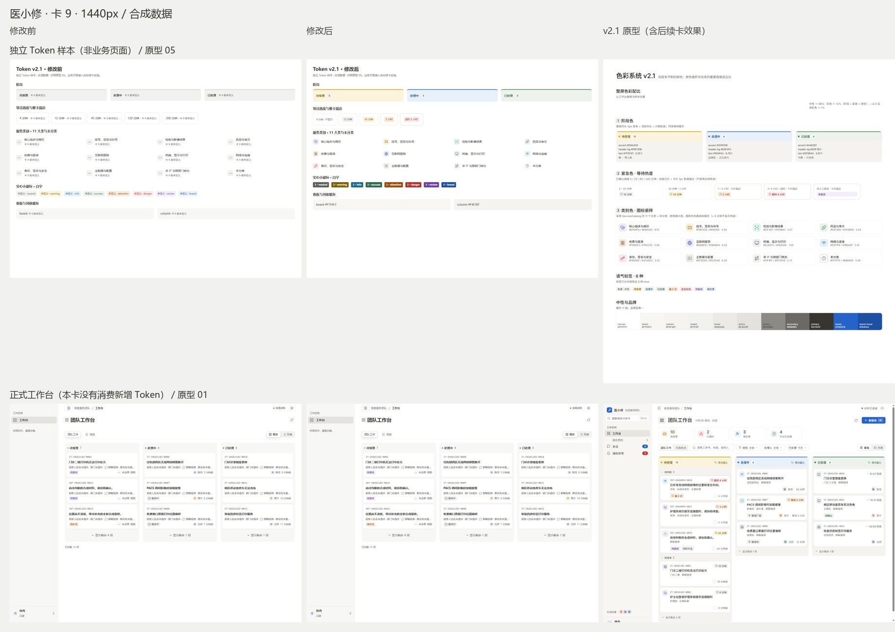

# PC 管理端 v2.1 · 卡 9 Token 基础

本卡对应 [v2.1 方案](design-system-v2.1.md) §3.1–3.4、[设计系统](design-system.md) §4.1.1 与原型 05；正式工作台与原型 01 的对照用于确认本卡没有提前改动页面。卡 10–16 未启动。

## 改动与文件

| 路径 | 责任 |
| --- | --- |
| `app/pc-admin/src/design/tokens.css` | 新增 71 个原始/语义 Token：阶段、11 类与未分类、紧急描边、board/column 暖灰、8 种 solid；原有 168 个 Token 值及 HeroUI 桥接不变 |
| `app/pc-admin/src/design/heat.ts` | 冻结阈值 `[5, 20, 60, 240]`，纯函数 `heatOf(startIso, nowMs)`；调用方选择状态起点并排除已处理事项 |
| `app/pc-admin/src/design/category-map.ts` | 唯一 domain → Token / lucide 图标映射、打印服务图标覆盖、未知大类中性回退 |
| `tests/pc-admin-design-foundation.test.mts` | 8 个边界、取整/时区/无效起点、目录一致性、服务图标回退与真实色值对比度，共 15 tests |
| `plans/typescript-migration/test-routing.json` | 注册上述入口并加入活动 v3-p09；不改变既有入口的宿主、flags 或资源合同 |
| `docs/ui/design-system.md`、`docs/ui/design-system-v2.1.md` | 先记录规范扩展及用户确认的精度处理，替代 v2.0 中“类别一律中性”的旧规则 |
| 本文与 `docs/ui/evidence/v21-card9/compare-*.jpg` | 交付说明、四宽前后与原型并排图 |

无数据库、后端、接口、业务命令、Ticket 状态值、权限判断、请求语义、依赖或默认 Feature Flag 变更。新增图标全部来自已安装的 lucide-react。类别映射只是视觉别名，不替代 ServiceCatalog 的服务事实或责任路由；未知大类不会因某个服务 code 猜出类别。

## 本次确认的规范补充

- 八种实心徽标使用对应 `--tone-*-fg` 深色，配 `--text-inverse` 白字；不使用较浅的 dot 色承载白字。
- 热度分钟/小时都向下取整；ring 为 `null / attention / danger` 语义键，由共享组件引用对应描边 Token。缺失、无效或未来起点、非有限 nowMs 返回 null。只接受带时区的 ISO 时间；不依赖浏览器本地时区，不读取系统时钟。非法公历日期也返回 null。
- 挂号类别指定色对 #FBF0D9 / #8A6100 的精确对比度为 4.898476:1。用户明确确认保留色值，以 WCAG AA ≥ 4.5:1 验收；表中 4.90 是两位小数显示，不能作为严格 ≥ 4.9 的证据。其它十类均超过 5.19:1。

## 验证

检查原件位于 `D:/CodexEvidence/pc-admin-v21-card9-20261102`。最终本地被测对象为 `8f96f2af0bbb7bbdf08ec5881c4239957cc4bb99` 上的未提交工作区，输入指纹 `fbbcd8981d9860a5b5358d1bf78c20be4943c540ccf9014afd5513cd0e68c3ee`，manifest SHA-256 `18c8fa6f5123b97a7b7a511d1794b7b1e0508fe007b526e6e0e6d261ba9c2098`。提交后的完整 head 由普通 PR CI 独立验证，不将 dirty 工作区结果重绑为 merge commit 的新运行。

本轮为普通 PR 的相关 selection 子集，不称活动全集、手动 full、certify、Electron 或现场验收。浏览器测试通过真实 loopback HTTP 与任务自有 PG18 的合成库加载正式 bundle；纯函数测试沿现有前端测试模式转译实际 browser TS 源码，不把源码测试称为业务运行制品。

| 检查 | 最终结果 |
| --- | --- |
| `npm run migration:build` | PASS；912 strict 模块、912 实际 Node 语法校验、2741 输出 |
| `node .build/tools/gate.mjs types` | PASS；完整 strict、负向类型、CSS、变量与 feature 语法门禁 |
| `node .build/tools/verify-artifact.mjs` | `ARTIFACT_VERIFIED_NOT_ACTIVATED` |
| v3-p09 相关 2 入口 | `pc-admin-design-foundation.test.mts` 15/15 + `web01-workbench.browser.test.mjs` 10/10；25 PASS、0 FAIL / SKIP / NOT_RUN |
| Stylelint / ESLint（既有 features 入口） | 0 / 0；无新增 lint 例外 |
| 设计检测 | 0 findings |
| 指令文档检查 / 工具回归 | PASS / 21 tests PASS（设计系统 2 + 指令文档 19；工具与样式源码此后未改） |
| 范围保护 | 原有 Token 168/168 值不变、桥接原字节不变、既有测试与组件选择器改动 0、依赖改动 0 |

首屏彩色面积估算属于卡 10 / 12；本卡不把独立 Token 样本的颜色占比当作工作台的 8–12% 验收。

## 四宽前后与原型

每张并排图从左到右为修改前 / 修改后 / 原型。上排为独立 Token 样本，前图明确标注尚未定义的 v2.1 Token；下排为真实合成工作台。样本只验证视觉基础，不是新增业务页面，不进入正式 bundle。原型包含后续卡的效果，不将其误记为本卡已实施。

| 宽度 | 对照 |
| ---: | --- |
| 1920 | [前后与原型](evidence/v21-card9/compare-1920.jpg) |
| 1440 | [前后与原型](evidence/v21-card9/compare-1440.jpg) |
| 1280 | [前后与原型](evidence/v21-card9/compare-1280.jpg) |
| 900 | [前后与原型](evidence/v21-card9/compare-900.jpg) |

四宽均核对了阶段/类别/热度/实心色，页面水平溢出为 0。900px 正式看板保留既有列内横向滚动。合成工单的分钟显示可随采样时间变化，不属于 Token 引起的视觉回归。

28 张原始 PNG 包含修改前、首候选后图与最终候选确认图；采图期间 POST=0。补非法日期校验后重采的 10 张图与首候选后图逐字节相同（`visual-confirmation.json`），四张最终并排图采用最终候选后图。

## 自检

| 自检 | 是 / 否 + 证据 |
| --- | --- |
| 前端未改业务命令、状态值、权限判断 | 是。仅设计基础与新测试；后端与功能源码差异为 0 |
| 测试选择器只增不删，既有测试没有放宽业务断言 | 是。既有测试改动 0、组件源码改动 0；新增纯函数测试独立注册 |
| 新增颜色全部经 Token，Stylelint / ESLint 为 0 | 是。色值集中在 tokens.css；两项既有 lint 均 exit 0，变量与 feature 语法门禁通过 |
| 彩色能对应阶段 / 紧急 / 类别 / 人 | 是（本卡新增部分）。阶段/紧急/类别分别定义，人物色继续沿原头像实现；品牌操作色沿既有规范 |
| 卡片上没有“未提供 / 未登记” | 否。正式卡片保留现状；资料收纳属于卡 12，仍依赖卡 11 |
| 有权限时每区域恰好 1 个 primary | 否（全局仍未完成）。本卡没有按钮改动，抽屉与会话的下一步分别属于卡 13 / 14；采图夹具为只读，无 primary |
| 热度阈值使用 heat.ts 常量，无组件硬编码阈值 | 是。四个阈值仅在 heat.ts 定义，8 个边界均直接执行该函数；组件接入留给后续卡 |
| 与原型并排核对四个宽度 | 是。四张并排图与仓库外原始 PNG；原型 05 核对 Token，01 核对正式页没有提前变化 |

## 失败、警告与未运行

- 初始旧 `.build` 校验为 `MIGRATION_INPUT_DRIFT`，未接受为当前制品。修改前前端由干净 main 源码独立构建到任务目录；最终完整构建和校验单独执行。
- 首轮纯函数测试 14 PASS / 1 FAIL：严格 4.9 对比度断言暴露了挂号类别的舍入差异。用户确认保留色值并采用 AA 后修改新增断言；未放宽任何既有业务断言，原失败日志保留。
- 首候选完成 build / types、2 入口 25/25 与工具 21/21 后，自审新增非法公历日期用例，先 RED（14 PASS / 1 FAIL）：2 月 30 日被 Date.parse 归一化，产生虚假的超时标签。补日期回环校验后 GREEN 15/15；后继最终候选结果独立列在上表，不覆盖首候选原件。
- 内置浏览器桥接不可用，按浏览器 skill 的回退流程使用仓库既有系统浏览器测试宿主；原型从用户 HTML manifest 解包渲染，用户原件未改。
- 构建保留既有登录等 chunk 超过 500 kB 的提示；本卡没有改拆包预算或屏蔽提示。
- 手动 full / certify、Electron 真机、真实外发、现场业务、生产部署及 Gate 验收均 NOT_RUN。

## 资源、回退与下一卡

本任务唯一源码/Git/runtime 写者为当前会话。自有 PG18 只监听 `127.0.0.1:58449`，max_connections=8；所有 fixture 库均为新建合成库并沿既有 finally 清理。停止前只余 postgres / template0 / template1，其他客户端 0；停止后 `pg_ctl status=3`、监听 0。采图浏览器 processes / profiles / commandTimers / sockets 全为 0。已按绝对路径白名单、无重解析点检查删除自有 `pgdata`、`before-bundle`、`baseline-bundle`；回执为 `cleanup-local.json`。报告、原始截图、全部失败和 NOT_RUN、用户原件、既有恢复引用、共享 `.build` 与依赖保留。无新增任务工作树。

回退使用独立 revert 撤销本 PR 的设计基础；无数据库回滚。本轮并未让业务页面消费新类别或热度，不更改现有请求和命令。

Backlog：卡 9 本地实现与验证完成，授权发布按 PR 记录收口。卡 10 的 Token 前置满足；卡 12 / 13 仍依赖卡 11 的只读分类与状态起点投影，本轮未启动。GitHub 无对应卡 9 的既存 Issue，不修改无关 Issue #117；PR 记录本次交付状态。完整发布 head、远端审查/CI、merge 与 main 快进和分支清理在 PR 及最终交付中读回，不预写成功。
