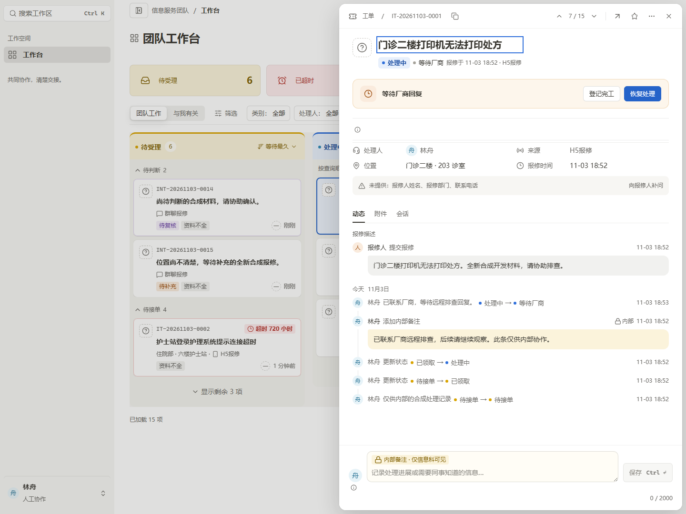
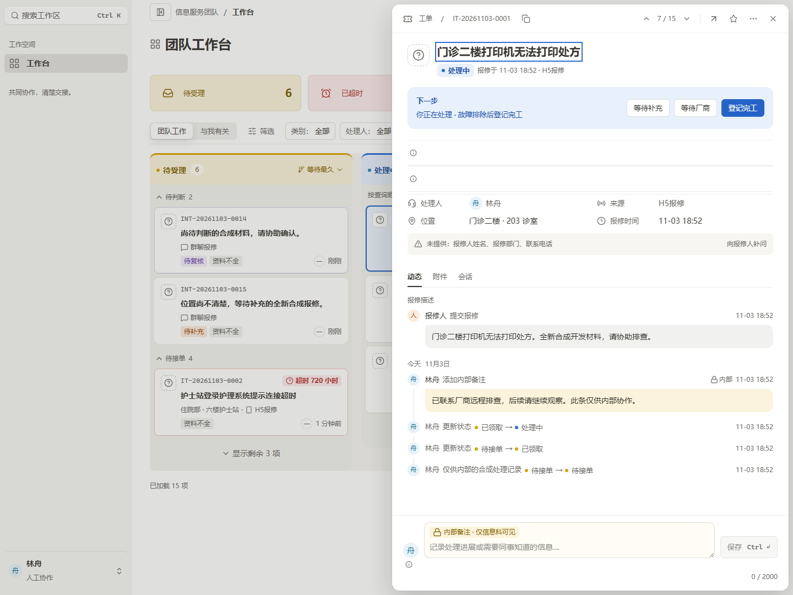

# 卡 18 Astra 最终有界复核

结论：**本次范围内的 A1/A2/A3、等待卡/备注输入精确色，以及第二轮指出的 CSS 级联与描边几何问题均已关闭；未发现新的 P1/P2 阻断项。** 八张实际截图均已逐张目视，8/8 文件哈希与 capture.json 相符。保留两类 P3 展示偏差和原型实时渲染限制，不能称“像素完全一致”。

候选绑定：`source_input_hash=7fa0589725988fbe3ad716e0a00143c03a5763365abe81ba644b9fe31fc26e8e`，工作区 `D:/worktrees/pc-admin-v211-card18` 的未提交改动。截图/测量来自 `D:/CodexEvidence/pc-admin-v211-card18-20261103/astra-review-r1/stable/`。本复核只读，没有修改源码、运行测试、启动浏览器/数据库或扩大验证范围。root报告的构建、types gate、流程3/3通过属于其独立验证，不冒充本复核重新执行。

## 逐项关闭

| 项目 | 状态 | 证据与判断 |
| --- | --- | --- |
| A1 外部记录被写成发送成功 | CLOSED | DetailPresentation.tsx 外部note已显示“报修人可见”；没有新增Delivery请求，也不再按audience推断投递成功。本组截图无外部摘要实例，关闭依据为本轮直接读取实现。 |
| A2 姓名/正文同一行、气泡字样与圆角错误 | CLOSED | 八图均为头行后接独立整行气泡。capture.json的note为14px/22px、padding10px12px、四角4/12/12/12。报修灰气泡与内部黄气泡正文像素均为#37352F。 |
| A3 描述上下两条多余横线、tabs间距16 | CLOSED | 两条描述边框已消失，描述保留原事实/分组；tabs20px、600字重、2px主文字下划线与底部发丝线正常。注意另有既有waiting控制器的宽行，见残余项，不与此处混为一项。 |
| 等待卡暖底与描边 | CLOSED | waiting四图背景#FDF6EC，内描边#F2D9B8；capture明确inset1px、无实体border额外几何。Clock18px、阶段徽标仍蓝，等待本身不改变active业务阶段。 |
| composer色与内部badge | CLOSED | 1440 waiting像素(1100,970)=#FFFDF6，(786,957)=#FBF3DB；近白输入底与黄色内部标记已区分。 |
| 保存按钮摆位 | CLOSED | 四宽均在输入框右侧、与其底部对齐，无遮挡/裁切；仍为原submit节点。截图为无输入的disabled态，本轮不证明新的输入/保存交互。 |
| 轨道选择器级联 | CLOSED | 局部selector已增加.ds-timeline-item；头像、轨道和文字左边沿在八图中一致。1440 waiting轨道样本rgb(231,230,230)，符合rgba(.12)合成白底。 |
| 顶栏横线/竖线与ghost样式 | CLOSED | 横线直接覆盖原inset shadow；1440 waiting y59为rgb(241,241,240)，符合rgba(.07)。上下导航与展开之间的竖线可见，ghost图标没有额外盒子边框。 |
| 单条时间/正文观察节点 | CLOSED（静态） | bubble与非bubble时间分支互斥，PersonalReadMaterial仍唯一；头行内时间没有复制观察正文。原权限/命令/UUID/UNKNOWN逻辑未改。 |

## 八图检查

每图提供测量均为抽屉720px、顶/右8px、primary=1、selected=1、overflow=false；本复核目视未见横向溢出、底部输入/保存裁切或时间被推出抽屉。900宽背景看板自身水平滚动条仍可见，它不构成抽屉溢出。

| 步骤 | 场景 | 结果 |
| --- | --- | --- |
| 1 | active 1920×1080 | 正常，气泡、按钮和footer对齐 |
| 2 | active 1440×1080 | 正常；保留既有等待控制器的两行i状态区域 |
| 3 | active 1280×1080 | 正常，无抽屉裁切 |
| 4 | active 900×1080 | 正常，720px浮层与footer保持完整 |
| 5 | waiting 1920×1080 | 正常，暖色等待卡与蓝色阶段区分 |
| 6 | waiting 1440×1080 | 对照重点；精确颜色、气泡与细线通过，保留一行i状态区域 |
| 7 | waiting 1280×1080 | 正常，无抽屉裁切 |
| 8 | waiting 900×1080 | 正常，等待主按钮和保存按钮均完整 |

capture.json另记active/waiting浏览器POST均0、核心status/version/assignee事实不变。本复核确认读到了这些记录，没有另行重复发请求。

## 保留的真实偏差

1. **P3，既有等待控制器的仅图标宽行。** active1440的NextStep下方y254–347有两行宽区域，waiting1440的y248–295有一行；可见内容仅i图标，原型没有。直接源码可解释为TicketWaitingActions的例行DraftStatus与既有ticket-notes边框/内边距，在本次启用合法等待能力的合成场景显露。不是本批命令逻辑新增，也不是可忽略的数据文本差异。由于当前任务保持独立控制器/恢复状态范围，本轮记录为非阻断残余；不得为了截图移除或隐藏真实读取、草稿、恢复、UNKNOWN状态。
2. **P3，Header既有状态图标表达仍与原型不同。** 实现继续用共享StatusBadge的6px实心阶段点；原型为13px环形/半填阶段图形。等待子状态实际为中性点+文字，原型为中性灰底暂停图标小标签。语义正确且没有扩大颜色含义，沿原共享状态组件保留；不能将它们说成已逐像素还原。顶栏的既有工单图标也保留，原型同处以文字为主。

以上无需在收口时扩大为新的功能/信息架构工作；若后续单独改善，只应处理展示，继续保留命令与恢复事实。

## 不可直接比较及未覆盖范围

- 原型同为WAITING_VENDOR，但工单是PACS/周宁/群聊/较早等待并有跟进安排；实际是打印工单/林舟/H5/刚挂起、无该跟进安排。类别瓷砖、属性条数、是否显示等待时长、跟进辅行、日期、人员、记录条数和按钮集合随真实数据/allowed_actions变化，不能照搬原型。当前恢复处理是唯一primary；登记完工仍是原允许操作的secondary，不换成原型演示的设置跟进。
- 原型画布1440×1060，实际为1440×1080；字体为Inter/Noto Sans SC与仓库系统字体栈的差异。不能输出整体相似度或逐像素误差百分比。
- 当前标题保留真实键盘focus-visible环；该环不是视觉缺陷，也未为截图移除。
- 报修描述标题、时间MM-DD格式、原事实顺序、字数计数和草稿状态按当前合同保留，未为了贴原型重排信息架构。
- 原型实时浏览器渲染仍未执行：此前file URL导航受安全策略拒绝，本轮没有重试、代理或其它绕过。原型比较依据是静态解包的真实DOM/CSS；实际应用图则是本候选正式bundle的真实截图。因此这是“有界源码+真实截图复核通过、有保留”，不是原型实时像素验收。
- 最终这轮没有查看新错误态图；错误态的首次已审图与root报告的流程3/3结果保留各自范围，不把八张稳定图当错误恢复复测。

## 关键截图

像素取色与8图哈希读回保存于同目录 `final-observations.json`。原始A1/A2/A3报告与第二轮报告保持不改写，关闭状态以本报告为准。
