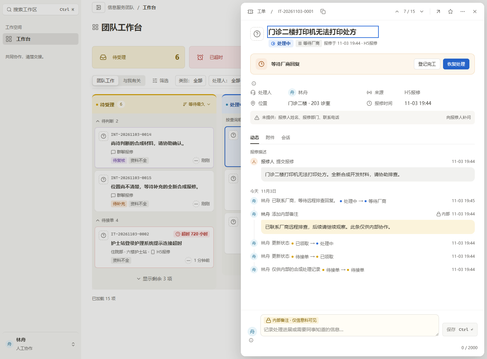
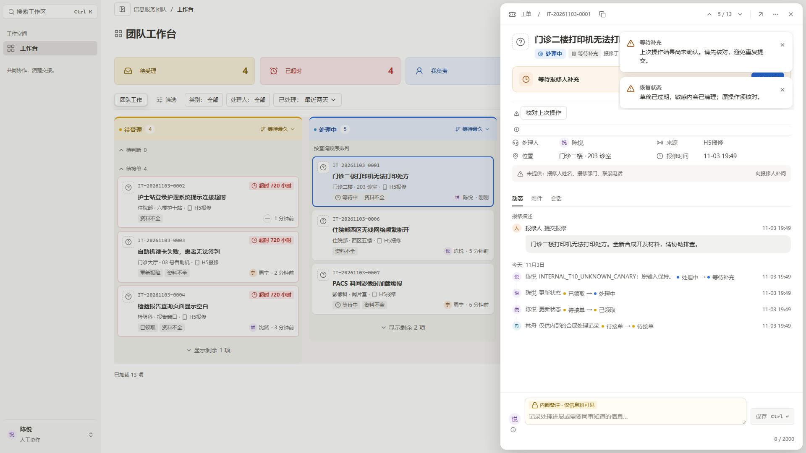

# 卡 18 两项 P3 收尾 · Astra 最终有界复核

**结论：两项 P3 均已关闭；前轮 A1/A2/A3 关闭状态保持；本轮没有发现新的阻断或待修缺陷。** 例行状态被安全收紧为小图标，UNKNOWN恢复内容和核对按钮没有被错误压缩/隐藏；Header阶段图形与等待标签已还原对应语义。

绑定候选：`source_input_hash=ae1c281d4a06038a620a1e4e551336fd948140963c0c4f9f725cbd64f916f39e`。复核内容仅为当前两项P3实际源码差异、8张四宽稳定图、1张1440×1060等待图与1张UNKNOWN实图。未修改源码，未启动浏览器/运行测试，未创建其它代理或扩大审查范围。

## 关闭项 1：例行草稿状态空宽行

- TicketWaitingActions.tsx 的实际差异只有返回section新增 `data-routine-draft`，未修改提交、确认、读取、恢复hook、UUID、原操作或权限判断。
- 标记要求draft.enabled/canSubmit、idle、无open/原操作ID/note/restoring/反馈，context非pending/fetching/error，且draft.message严格等于例行说明。输入即使只有空格也不会命中 `!note`，属于保守保留。
- CSS进一步要求容器不含form/button/alert；只改display、内外边距和border，没有display:none、固定高度或overflow裁切。父workflow只在所有可见直接子项均为例行标记时取消padding/border，非例行恢复面默认保留。
- stable/capture.json的例行图标尺寸为20×20，active两枚、waiting一枚；整个workflow高度21px。原title“草稿仅在当前浏览器恢复，最长24小时。”仍在，aria/sr-only内容未变。
- 四种宽度均已目视：前轮仅i图标的多条宽行与分隔线消失，提示图标仍可见。保留这些有事实意义的图标不属于残余缺陷。

## UNKNOWN恢复面核对

已检查 `unknown-preserved-1920.png`；归档图SHA-256为 `a18e02d5b469484003b25735db4943c482ee2d65c2a32dff923564d70df6351d`，与先检查的临时原件及unknown-capture.json完全相同，source_input_hash也与本候选相符。

实图中以下内容均完整可见：

- “上次操作结果尚未确认。请先核对，避免重复提交。”
- “草稿已过期，敏感内容已清理；原操作须核对。”
- 恢复警告图标及“核对上次操作”按钮。

恢复控制器保持正常宽行，未套用20px例行状态压缩。旁边另一个没有恢复负担的例行i仍可独立紧凑显示，说明不是全局压缩/隐藏所有状态。

root提供的采图方法为编译T10原用例的外置副本，仅在明确ACK前插入截图检查点，原断言保留；capture-unknown.log记录1/1 PASS。请求计数与原UUID/显式GET行为属于该测试证据，本复核没有重新发请求或执行测试。

## 关闭项 2：Header阶段图形与等待标签

- DrawerStageGlyph为Drawer局部展示组件，stage输入仍来自原item.column；pending虚线环、active半填环、closed勾选圆使用既有stage Token，不建立第二套业务状态。
- 8张稳定图中的active阶段图形实测13px；waiting图显示Pause和中性灰底等待标签，active图不显示Pause。
- “处理中”“等待厂商”等原文本均保留，SVG为aria-hidden且不可聚焦，图形不会替代可访问状态文字。
- 原StatusBadge/Status节点仍在，旧圆点只在Header对应选择器下隐藏；Timeline状态点保持原展示。Status组件的review_reason“待复核”Tag仍保留，局部CSS只命中.ds-status-badge，没有隐藏复核Tag或其它状态标签。
- 本组实际截图覆盖active/WAITING_VENDOR，并由UNKNOWN图补充WAITING_REQUESTER；pending/closed图形及复核Tag只做源码核对，不声称已取得对应实图。

## 图片与范围

| 已检查步骤 | 结果 |
| --- | --- |
| active 1920、1440、1280、900，各1080高 | 全部正常；例行状态紧凑，Header文字/图形与输入保存区完整 |
| waiting 1920、1440、1280、900，各1080高 | 全部正常；暖色等待卡、Pause标签、气泡/时间线无回归 |
| waiting 1440×1060 | 正常；与原型画布高度一致，footer未被截断 |
| UNKNOWN 1920×1080 | 恢复警告、完整提示与明确核对按钮保留；非例行区域未被compact命中 |

8张有登记SHA的稳定截图已核对8/8一致，另记录1060高图与UNKNOWN图哈希。各稳定图capture测量仍为720px抽屉、顶/右8px、overflow=false、唯一primary与唯一选中页签。未见抽屉横向溢出或底部保存按钮裁切。

原型实时渲染仍未执行，也没有重试此前受限file导航。新增1440×1060图解决了比较视口高度这一项差异，但原型与当前数据、字体、人物/类别/时间、原业务按钮和草稿提示仍不同。因此关闭的是已证实的两个具体P3问题，不宣称原型整体逐像素一致。

root的20入口全批在本次复核交接时仍运行中，本报告不提前标该批PASS。构建/types、流程3/3、T10原UUID恢复与T12结果由root各自证据说明，本复核只对上述源码与图片给出结论。

## 关键图

本报告与 `astra-final-observations.json` 为本轮追加证据；此前报告与原始失败/限制保持不改写。
