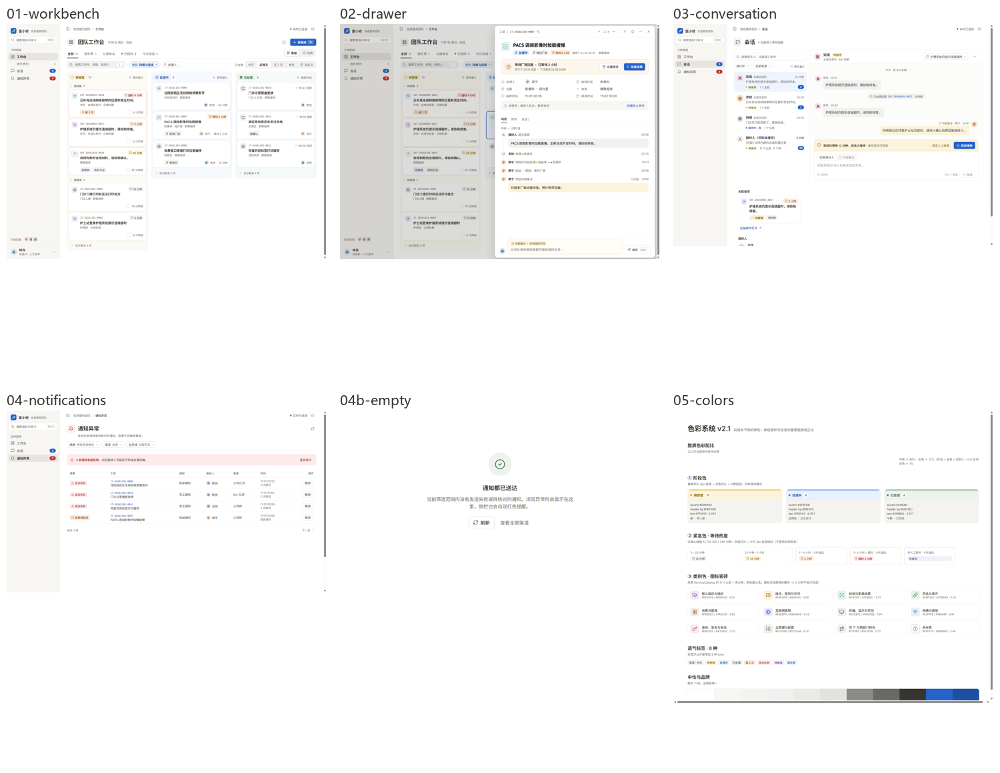

# v2.1.1 离线正式画布 · 卡21补验

2026-11-04 用户指定离线原件，并明确最终范围：**只用01–05（含04b），共6页；列头只以01为准；06–08全部为讨论稿，不参与验收。**

原件：`D:/Projects/Fault-Reporting-WeCom-Assistant/docs/ui/prototype/医小修 PC 管理端 v2.1.1 设计原型.html`，4,787,932字节，SHA-256 `cd4d51460e8c9e2e4136892b969f4af40d8369cd0ba419eecbe28d2d62e1ce7c`。原件只读保留；gzip/base64解包只写到本次本地Evidence目录。

## 对上一轮限制的纠正

该文件有9个完整压缩子画板，每个子画板又包含运行脚本、Inter字体与HTML模板。外层about:blank是包内画板引用，并不表示内容缺失。上一轮未继续解包而给出「本地仅有引用、缺少画板」的判断不完整，现予撤回。在线页是否要求登录已经不再阻断本次离线画布验收；以前的测试/截图/manifest仍保持其历史对象，不追认成当时已完成原型验收。

## 正式画布

| 画板 | 原始视口 | 视口截图 | 完整内容 |
| --- | --- | --- | --- |
| 01 工作台（列头唯一基准） | 1440×1060 | [查看](01-workbench.png) | [全页](01-workbench-full.png) |
| 02 抽屉 | 1440×1060 | [查看](02-drawer.png) | [全页](02-drawer-full.png) |
| 03 会话 | 1440×1000 | [查看](03-conversation.png) | [全页](03-conversation-full.png) |
| 04 通知异常 | 1440×820 | [查看](04-notifications.png) | [全页](04-notifications-full.png) |
| 04b 通知空态 | 880×440 | [查看](04b-empty.png) | [全页](04b-empty-full.png) |
| 05 色彩系统 | 1440×1320 | [查看](05-colors.png) | [全页](05-colors-full.png) |

没有把06、07、08放进本目录的参考画布或总览。05阶段色示意中的旧色条/计数胶囊文案只用于历史色值说明，结构与01冲突时严格使用01。

## 当前实现对照

以下保留未遮罩的原始像素差异。合成数据、业务状态、权限/开关、当前API字段及v2.1.2明确变更会改变像素，差异率是定位工具，**不是整体一致或业务验收通过率**。

| 正式画板 | 原型 / 当前 | 50%叠加 |
| --- | --- | --- |
| 01 | [对照](compare-01-workbench.png) | [叠加](overlay-01-workbench.png) |
| 02 | [对照](compare-02-drawer.png) | [叠加](overlay-02-drawer.png) |
| 03 | [对照](compare-03-conversation.png) | [叠加](overlay-03-conversation.png) |
| 04 | [对照](compare-04-notifications.png) | [叠加](overlay-04-notifications.png) |
| 04b | [对照](compare-04b-empty.png) | 原型是独立空态组件，当前为页面中的空态，不将不同坐标直接当作缺陷 |

原始像素差异采用同尺寸重叠区域，记录任一通道非零、通道差大于16/255及平均绝对差；不替换业务文字，不遮罩失败、权限或缺失字段。结构化原件在 `D:/CodexEvidence/pc-admin-v212-card21-20261104/offline-canvas-audit/pixel-audit.json`。

## 本卡校准与保留的差异

- **G1**：01里生效类别胶囊从名称起排，不带左图标；未生效处理人带14px图标，图标/名称/箭头之间6px。本卡只校准共享FilterChip的可选图标显隐、描边对齐补偿、间距及文字垂直居中；保留24px独立清除按钮、原Select、URL与业务控制器。99×30处理人和135×30「类别 网络与连接 ×」为01的几何参照；三页30px高、12px箭头、600值字重保持。
- **列头**：01的三种标签均77×26px、13px/600，计数在外、13px secondary，无顶部色条。当前已符合这些结构/尺寸/色值，未修改BoardColumn、StageGlyph或Drawer源码。像素叠加仍可显示字形/图标栅格差异，不写成零像素差异。
- **05色板**：阶段、正文/品牌及11个已分类类别的39个核对值一致；加上未分类两项共41项，40项一致，未分类底色按卡17明确要求保留muted而非旧原型白底。当前hover/sidebar中性色还存在与旧参考的RGB差别，按现有规范保留，未越界修改tokens.css；原board/column底板Token已由卡20 T2废弃，不从05旧示意恢复。
- **v2.1.2具名覆盖**：G1/C6/N1的30px共享胶囊、C2–C5日期/渠道与标识、S10去会话副标题并统一12px、N2的固定列与56px行高、C9/N4按需分页，按本次用户任务文字验收，不能反向恢复旧画板的控件/数据状态。
- **N3**：原型有工单号/标题/接收人姓名；现有DTO没有这些字段。保留原合同缺口，不从safe_summary猜字段、不逐行请求父对象、不将原型演示字段冒充实际API能力。
- **全局/既有差异**：侧栏产品标识、在线同事、班次文字与原型演示总数不由本卡补造；T8/T9明确不追的圆角/遮罩差异保留。原型03的静态flex示例在所给宽度下会把关联栏换到下面，当前保留已授权的三栏响应式布局，不以导出示例覆盖信息架构。

## 渲染环境与结论边界

本次原型以自有Chrome、DPR=1、原始视口尺寸渲染。HTTP(S)资源请求被阻断，包内脚本和Inter可用；导出文件仍声明未内嵌的Noto Sans SC外链字体，字体loading归零后使用系统回退。字体状态和原始DOM/BCR均保存；不通过偷偷替换字体或业务数据来降低差异率。

本轮最终构建/测试、原件哈希复核和资源关闭结果见[执行记录](../../../../../plans/pc-admin-design-v21/card-21.md)。本目录只补充正式离线参考，不宣称六页与当前产品达到整页零像素差异，也不代表CI、Electron或现场批准。

## 最终候选与回归

输入指纹 `f216f9dcb91ce8dced635997037c551f8c45fa112616296f5ddb9cfda4975ff7`，manifest `2b05fcc44c2eddb41901f570da3456501197bad324f946c9cab5c5bea76a26ed`。本次校准后的35入口单批178/178 PASS，0失败/取消/SKIP/TODO，NOT_RUN空；build/types/lint/artifact通过。前轮分段178 PASS保留原对象，不能替代或重绑本次结果。

最新四宽截图位于current-four-width；正式尺寸重拍的产品截图以current-开头。原始数据/哈希在本次Evidence的delivery.json。仍未提交、推送或建PR，N3完整字段目标仍未实现。
