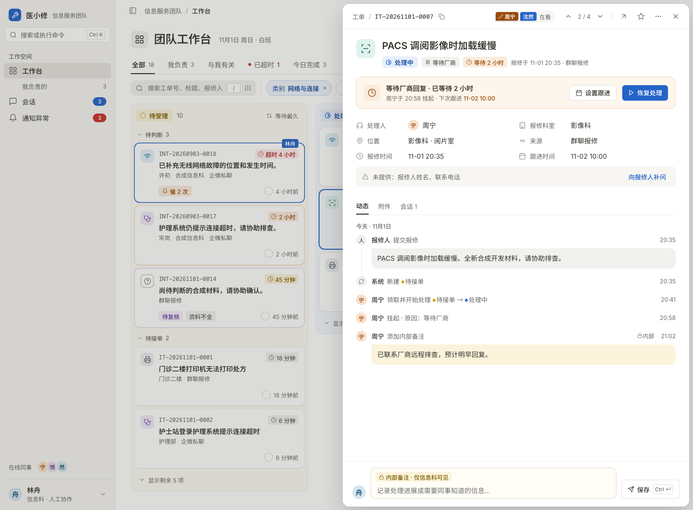
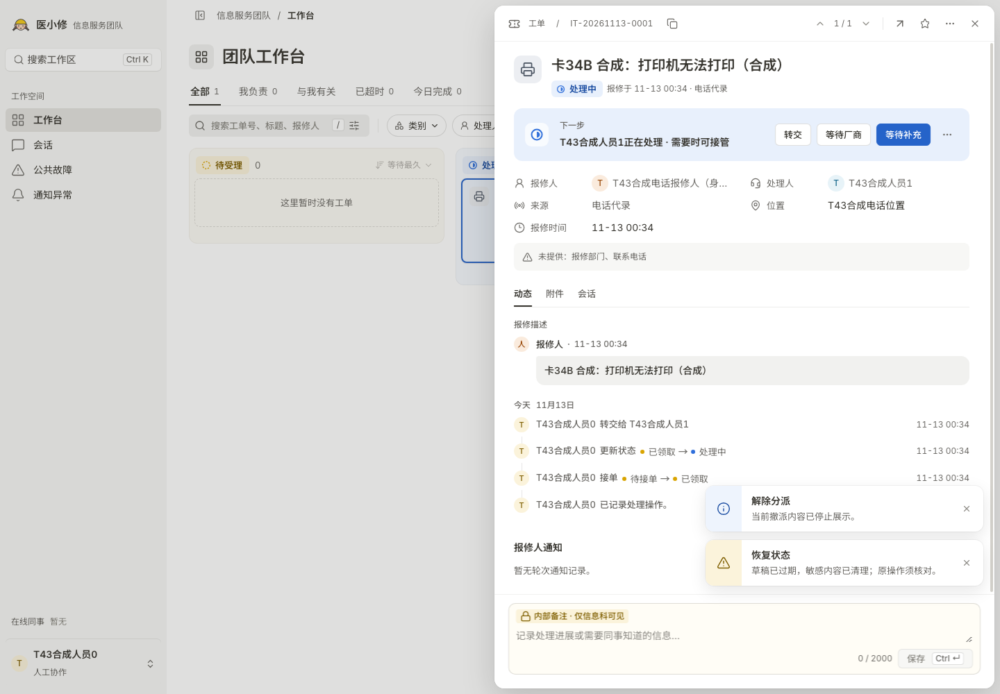
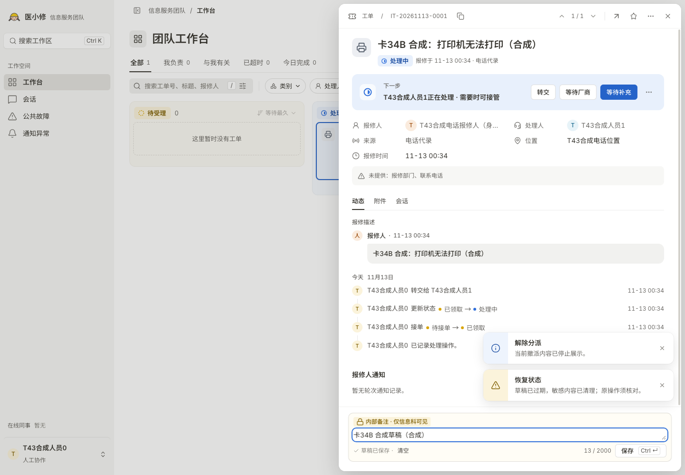

# v2.2.7 卡 34B · 详情页对齐原型（画板 02）

环境：macOS 26.6.2，headless Google Chrome 157.0.8103.79，真实回环 HTTP + PostgreSQL；合成数据标「（合成）」。`artboard-02-drawer.png` 由 v2.2.6 原型文件中的画板 02 用同一浏览器在 1440×1060 渲染。

| 原型画板 02 | 实现：处理中 | 实现：输入区有草稿 |
|---|---|---|
|  |  |  |

断言（`tests/pc-admin-card34b-detail.browser.test.mts`，1/0）：

- 「处理记录」里有接单行（`data-assignment-history-row=FIRST_RESPONSIBILITY`，「… 接单」）和转交行（`RESPONSIBILITY_CHANGE`，「… 转交给 …」）；没有「接单与交接链」卡片，页面上没有「最多保留 200 条」「仅为当前已读取范围」「重新读取接单链」「当前没有可提交的撤派 / 退回动作」。
- 没有可执行动作时，撤销派工 / 退回待安排区块不可见。
- `.detail-workflows` 不画线（只有块自身一条 hairline）。
- 输入区没有头像；有草稿时底栏左侧可见文字为「草稿已保存 · 清空」，带 ✓ 图标，`--fs-xs`、`--text-tertiary`，「清空」是文字按钮，没有单独的「丢弃草稿内容」按钮。

原「交接链」断言迁移到时间线：`t13-production-history`（1/0）、`t13-history-window`（2/0，205 条真实交接事实中 200 条标注到各自的时间线行，10 次分页读取、每次 20 条，无写请求；登出竞态改由「重新打开详情」触发一次新的读取）。

截图中的「解除分派 · 当前撤派内容已停止展示」「恢复状态 · 草稿已过期…」两条提示是现有行为（转交后撤派权限消失、合成环境的草稿恢复），文案归 34C 处理。
