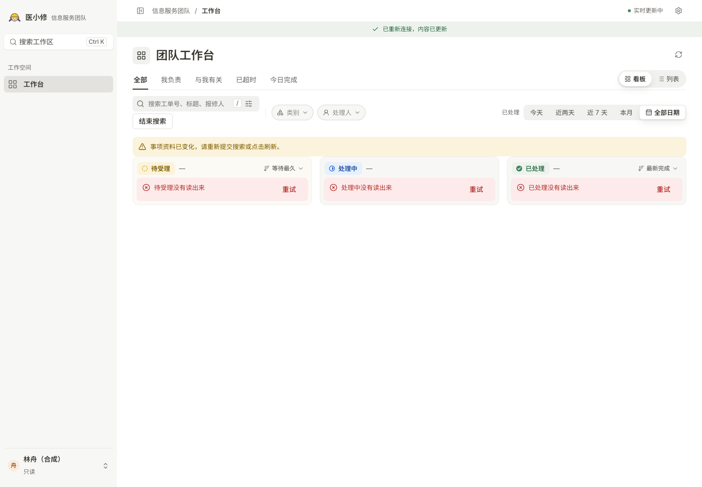

# Backoff hint invalidation — PR 192

> Correction: the search-production failure below was a 35A regression against origin/main, not a legacy failure. The previous HEAD-only comparison did not establish main behaviour. See the [product correction and passing unchanged tests](../24-search-compatibility/README.md). Historical TAP, identities and counts below are preserved.

Current baseline `c63b71dd1d71ef9fd0f665f4f9466dd97c6bff53`, uncommitted worktree. Source input `bedc67f87e03b060c6d3f56ae212f07ee06dc16ce574dbed6e94cebfbf476382`; artifact `0565dc4755f4fcf5086175a075083ddd5c835ebed7df41ceaf095164c0af783a`. All final entries below use this one compiled artifact. No commit/push, deployment, new poller, API or permission change. macOS 26.6.2 / Chrome 157.0.8103.79 / Node 24.18.0; local isolated Postgres and real system Chrome. Linux was not run.

## Root cause and chosen design

The read-backoff condition wrapped whole SSE callbacks, dropping search and presence invalidations along with extra refreshes. Recovery excludes search, which also opts out of reconnect/focus refetch. A successful recovery therefore could not repair the lost invalidation.

Valid decoded named events and ordinary `message` deliver `onHint` immediately; the valid activity event delivers `onActivityHint`. Only `refresh()` waits for the existing admitted retry. Immediate delivery is safe here: the existing hook cancels the search GET, discards the stale snapshot and presents `SEARCH_REFRESH_REQUIRED`; it never automatically restarts search or performs a business write. Deferring could leave known stale results indefinitely if the budget is exhausted. The decoder, source/identity fences, 1s/3s/8s retry deadlines, normal 5s cadence, and outside-backoff/no-retryDelays semantics are unchanged.

The browser test also exposed a presentation gap: invalidation correctly cleared cards but the page showed only generic column errors. Workbench now composes the existing warning InlineAlert with the existing Chinese refresh-required message. It retains the existing error regions and selectors. No new visual pattern or feature logic.

## Final per-entry results

| Entry | Result | Evidence |
| --- | --- | --- |
| `tests/pc-admin-card35a-states.browser.test.mts (CPU 1x)` | PASS 10/10 | [TAP](states-1.tap) |
| `tests/pc-admin-card35a-states.browser.test.mts (CPU 4x)` | PASS 10/10 | [TAP](states-4.tap) |
| `tests/wbint-t38-realtime.test.mts` | PASS 11/11 | [TAP](01-wbint-t38-realtime.test.mts.tap) |
| `tests/wbint-t38-realtime.integration.test.mts` | PASS 2/2 | [TAP](02-wbint-t38-realtime.integration.test.mts.tap) |
| `tests/wbint-t38-realtime.browser.test.mts` | PASS 2/2 | [TAP](03-wbint-t38-realtime.browser.test.mts.tap) |
| `tests/wbint-t38-protocol.browser.test.mts` | PASS 2/2 | [TAP](04-wbint-t38-protocol.browser.test.mts.tap) |
| `tests/pc-admin-copy-terms.test.mts` | PASS 6/6 | [TAP](05-pc-admin-copy-terms.test.mts.tap) |
| `tests/t41-search-production.browser.test.mts` | FAIL 1/2 | [TAP](06-t41-search-production.browser.test.mts.tap) |
| `tests/t41-search-refresh-and-long-pages.browser.test.mts` | PASS 2/2 | [TAP](07-t41-search-refresh-and-long-pages.browser.test.mts.tap) |
| `tests/t41-search-pending-hint.browser.test.mts` | FAIL 0/2 | [TAP](08-t41-search-pending-hint.browser.test.mts.tap) |
| `tests/workbench-toast-feedback.browser.test.mts` | PASS 1/1 | [TAP](09-workbench-toast-feedback.browser.test.mts.tap) |
| `tests/workbench-detail-restructure.browser.test.mts` | PASS 2/2 | [TAP](10-workbench-detail-restructure.browser.test.mts.tap) |

| Gate | Result | Evidence |
| --- | --- | --- |
| `npm run migration:typecheck` | PASS | [output](typecheck.txt) |
| `npm run migration:build` | PASS | [output](build.txt) |
| `npm --prefix app/pc-admin run lint:css` | PASS | [output](stylelint.txt) |
| `npm --prefix app/pc-admin run lint:features` | PASS | [output](eslint.txt) |
| `verify-artifact` | PASS | [output](artifact-verification.txt) |
| `check-agent-docs` | PASS | [output](agent-docs.txt) |
| `check-agent-docs tests (20/20)` | PASS | [output](agent-docs-tests.tap) |

[Working-tree local links](local-links.json), [rerunnable link checker](../../checks/check-local-links.txt), [machine results](results.json), [artifact](artifact-proof.json), [scope and all original assertions retained](scope.json). The existing registered unit/state entry files were extended; routing and test policy were not changed. The unit cases assert callback delivery during every backoff, unchanged timer identity and exact read times 0/1000/4000/12000, recovery to live, invalid-event rejection, and unchanged ordinary/legacy paths.

The browser cases use actual authorized search/GET data and a controlled failed business read while the native SSE remains connected. A valid synthetic hint clears the old results, adds the notice, admits no extra immediate read, and the one-second recovery returns to live while the notice persists. Only explicit user refresh restarts search; no business POST or additional stream is created. The case waits for the real search request and committed search UI rather than treating the URL change as readiness. Its existing manual-projection fixture mode prevents seed-projector updates from invalidating the initial snapshot before the controlled fault; native SSE and the product listeners remain active. [Five targeted repeats at each CPU rate](probes/README.md) passed before the final complete files.

[Normal receipt](states-1-backoff-search.json), [4x receipt](states-4-backoff-search.json); screenshot 1440×1000, synthetic fixture data.

## Existing search failures — preserved assertions

- `t41-search-production.browser.test.mts`: 1/2 PASS; first case times out waiting for old empty copy `没有符合这些条件的可见事项`, while committed HEAD already renders `没有符合条件的工单`. It does not reach its later offline assertions. The other case passes.
- `t41-search-pending-hint.browser.test.mts`: 0/2; both fail the unconditional Windows D-drive temporary-directory precondition on macOS before fixtures/browser scenarios run. These two held-response scenarios were NOT_RUN beyond preflight.
- [HEAD/worktree hashes and cause checks](legacy-search-checks.json) show both tests are unchanged. Their original assertions and failures are retained; neither was weakened to obtain green results. The current bug is independently covered by the added unit and normal/4x browser scenarios. These two legacy entries prevent claiming that every requested regression is green.

## Investigation and history

- [Original unit failures](investigation/unit-before-fix.tap): ticket.updated, message and activity callbacks fail (3/4); [isolated client fix](investigation/unit-after-fix.tap) passes 4/4. These are diagnostic transpilation runs, not final artifact checks.
- [Missing visible notice](investigation/missing-notice.tap), [DOM diagnostic](investigation/missing-notice.json): the corrected client already discarded search data; the generic column rendering hid the reason.
- [Intermediate normal run](investigation/intermediate-states-1.tap) passed 10/10; [intermediate 4x run](investigation/intermediate-states-4.tap) failed 1/10 because the new test read the previous board frame after a URL change, before the search GET. [Diagnostic](investigation/search-readiness-failure.json). The final test adds readiness conditions while preserving its assertions. Neither intermediate run is counted as final.
- [Previous delivery report](report-before-backoff.txt) and all earlier evidence stay assigned to their original heads/artifacts. The prior ten-run stress matrix is historical; this request runs one complete normal and one complete 4x file on the current build.

A later [normal run](investigation/readiness-states-1.tap) correctly invalidated search on an uncontrolled seed-projector hint before the intended fault, so its initial-data wait timed out; [diagnostic](investigation/fixture-startup-hint.json). The [4x run](investigation/readiness-states-4.tap) happened to pass. The fixture now uses its existing manual-projection mode to make the baseline quiescent. These intermediate results are historical, not counted as final.

## Limits and unchanged scope

The full CI selection and actual Linux runner were not rerun. The prior unknown-empty-first-subgroup geometry and independent UNKNOWN confirmation-contract deviations remain recorded in the [main evidence](../../README.md#open-questions--偏差). 35B/35C, visual manifest/baselines, feature implementations, useRealtime, tokens and business/API/authorization contracts remain untouched. The deferred 35B manifest append stays deferred.
