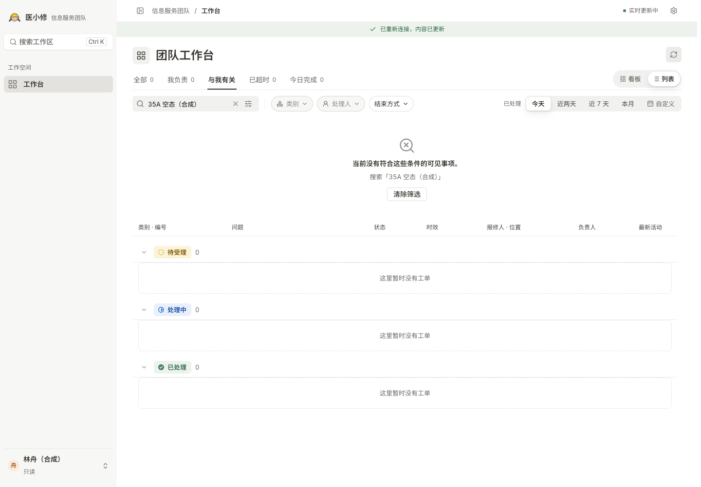
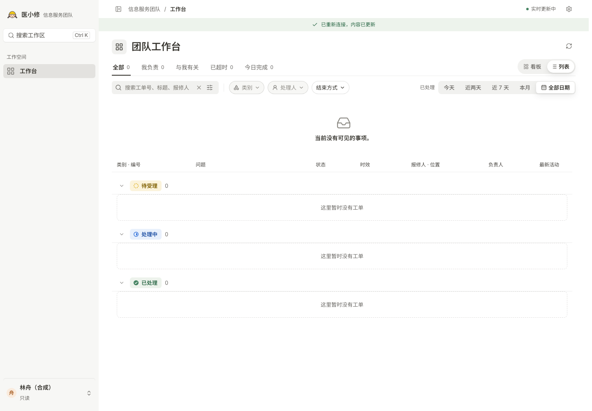
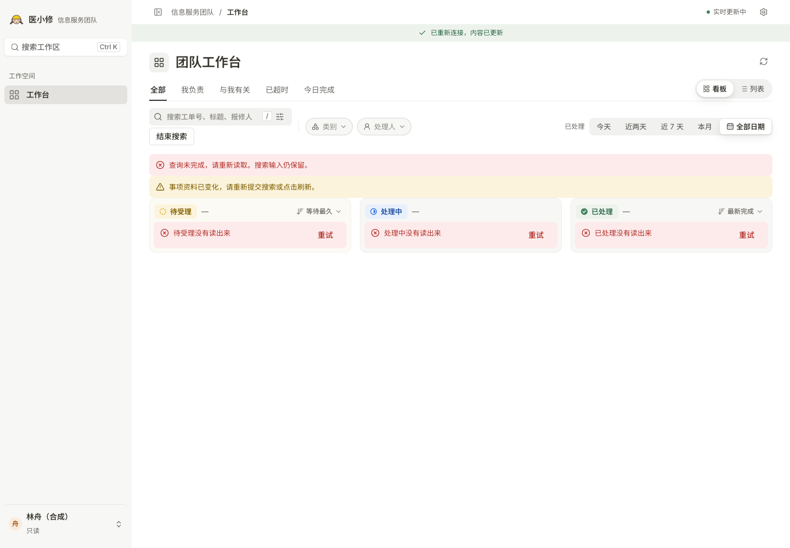

# Search presentation compatibility — PR 192

Baseline `c63b71dd1d71ef9fd0f665f4f9466dd97c6bff53`; comparison `origin/main` = `67999466deedacea714812f7cc23884c2a5b7db1`. All final application entries below ran on this one uncommitted source input `d80ecfcf37c23b566215980c1e4737e61a4966ee5823abf23b4b42a2c13d5a75`, artifact `3b69f0debb4be023f04928d8dbc104c0bfe85f213c5866e5d81e30e06c1cd933`. macOS 26.6.2 / Chrome 157.0.8103.79 / Node 24.18.0; isolated fixture databases on the user-provided local Postgres. No commit/push.

## Correction and product changes

The previous report incorrectly called the search-production failure legacy because the test matched HEAD. That established only that HEAD still failed. Comparison with origin/main confirms that 35A removed the search-specific copy; it is a 35A regression. The prior failure TAP and report are preserved, and the classification is withdrawn.

- Search empty uses the unchanged `searchEmptyMessage(parsed.criteria)` as the page EmptyState title: `当前没有符合这些条件的可见事项。` / `当前没有可见的事项。`, with `role=status` and `data-search-state=empty`. Only a search with actual criteria gets the filtered variant and one clear action. No-criteria search retains main behaviour without a misleading clear button. Non-search filtered empty keeps `没有符合条件的工单`.
- Clear search removes every canonical SEARCH_KEYS field plus search/cursor/limit, resets range=all and scope=team, and retains the chosen view. The existing “结束搜索” function is byte-for-byte unchanged against main and retains its original board date/scope behaviour.
- Generic search failure again shows `查询未完成，请重新读取。搜索输入仍保留。` with `data-search-state=error` and `role=alert`, composed with the existing danger InlineAlert. The accepted refresh-required warning remains.
- Empty search retains the board columns / native list table, one shared header and three empty stage rows, as on main. The page EmptyState replaces the former plain summary only; it no longer consumes the table.
- card12 caught an additional 35A geometry regression: activity width was enlarged from main’s 92px to 104px. Restored the original token expression; inline-size containment keeps the retry marker from enlarging its header. Existing scrollbar stabilization stays. New assertions keep the activity header within 1px across stale refresh and retain the original retry hit/clip checks.

## Search strings and selectors compared against main

[Complete comparison and JSX text/attribute inventories](main-search-audit.json), [Workbench diff](Workbench.tsx.diff.txt), [WorkTable diff](WorkTable.tsx.diff.txt), [table CSS diff](work-table.css.diff.txt). The search feature, canonical criteria module, PageHeader, search-production test, pending-hint test and card12 test are all byte-identical to origin/main. Search form strings, controls, field names, captions, validation text, URL keys, toolbar `.tools`, group labels, preference keys and original end-search behaviour are retained.

| Search-facing difference | Final disposition / card rule |
| --- | --- |
| Global empty copy / status selector | Restored the exact helper and role; 35A EmptyState/default page size remains. The complete original sentence is an explicit exception to the general short-title guidance. |
| Global query-error copy / alert selector | Restored exact main copy and role using InlineAlert; existing added board/table error selectors remain. |
| Empty list stage `暂无事项` | Intentionally uses compact EmptyState `这里暂时没有工单`, per A1.4 / A2. `.ds-list-empty` row and stage/header selectors remain. |
| Plain `列：正在读取…` and initial spinners | Intentionally replaced by shared skeleton / delayed loading / slow retry per A1.1–A1.2 and A2. |
| No-data per-column raw error + `重新读取` | Intentionally replaced by block ErrorState (`列没有读出来`, `重试`) per A1.5 / A2 and the no-technical-copy rule. The aggregate search error sentence is restored separately. |
| Old `confirmed-facts`, per-column `连接中断…显示最近已确认资料`, `读取未完成` | Intentionally replaced by 60% retained content and header `未更新 · 重试`, per A1.3 / A1.5; superseded classes were removed as A2 required. |
| Header labels, column widths, group text/keys | Same values as main; groups/real headers and skeletons share definitions. 92px activity width restored. |
| New loading / refresh / error wrappers and shared shell connection/read-only presentation | Intentional A1/A2 state composition, including additive `data-refreshing` / skeleton selectors. Search field/toolbar selectors are unchanged. |
| Refresh-required notice from accepted backoff fix | Retained; does not replace the original generic error copy, change hint delivery, or restart search automatically. |

## Final checks

| Entry | Result | Evidence |
| --- | --- | --- |
| `tests/pc-admin-card35a-states.browser.test.mts (CPU 1x)` | PASS 10/10 | [TAP](states-1.tap) |
| `tests/pc-admin-card35a-states.browser.test.mts (CPU 4x)` | PASS 10/10 | [TAP](states-4.tap) |
| `tests/t41-search-production.browser.test.mts` | PASS 2/2 | [TAP](01-t41-search-production.browser.test.mts.tap) |
| `tests/pc-admin-card12.browser.test.mts` | PASS 18/18 | [TAP](02-pc-admin-card12.browser.test.mts.tap) |
| `tests/t41-search-refresh-and-long-pages.browser.test.mts` | PASS 2/2 | [TAP](03-t41-search-refresh-and-long-pages.browser.test.mts.tap) |
| `tests/pc-admin-copy-terms.test.mts` | PASS 6/6 | [TAP](04-pc-admin-copy-terms.test.mts.tap) |
| `tests/wbint-t38-realtime.test.mts` | PASS 11/11 | [TAP](05-wbint-t38-realtime.test.mts.tap) |
| `tests/wbint-t38-realtime.browser.test.mts` | PASS 2/2 | [TAP](06-wbint-t38-realtime.browser.test.mts.tap) |
| `tests/wbint-t38-protocol.browser.test.mts` | PASS 2/2 | [TAP](07-wbint-t38-protocol.browser.test.mts.tap) |
| `tests/wbint-t38-realtime.integration.test.mts` | PASS 2/2 | [TAP](08-wbint-t38-realtime.integration.test.mts.tap) |
| `tests/workbench-toast-feedback.browser.test.mts` | PASS 1/1 | [TAP](09-workbench-toast-feedback.browser.test.mts.tap) |
| `tests/workbench-detail-restructure.browser.test.mts` | PASS 2/2 | [TAP](10-workbench-detail-restructure.browser.test.mts.tap) |
| `tests/t41-search-pending-hint.browser.test.mts` | NOT_RUN on macOS; main has the same unconditional D-drive precondition | [source comparison](main-search-audit.json) |

| Gate | Result | Output |
| --- | --- | --- |
| `npm run migration:typecheck` | PASS | [output](typecheck.txt) |
| `npm run migration:build` | PASS | [output](build.txt) |
| `npm --prefix app/pc-admin run lint:css` | PASS | [output](stylelint.txt) |
| `npm --prefix app/pc-admin run lint:features` | PASS | [output](eslint.txt) |
| `verify-artifact` | PASS | [output](artifact-verification.txt) |
| `check-agent-docs` | PASS | [output](agent-docs.txt) |
| `check-agent-docs tests (20/20)` | PASS | [output](agent-docs-tests.tap) |

[All working-tree document links](local-links.json), [machine results](results.json), [scope and unchanged original assertions](scope.json), [artifact](artifact-proof.json). The existing states entry adds assertions for both empty sentences, status/page semantics, the absence of an unfiltered clear action, actual criteria/date/scope clearing, the retained native header/three stages, original error text/alert role, and the 92px retry geometry. The t41-production and card12 assertions were not edited. The accepted backoff client, realtime unit tests and API note remain unchanged this turn.

## Current screenshots

1440×1000, DPR1, synthetic fixtures; [hashes](screenshots.json).

| Criteria present | No criteria |
| --- | --- |
|  |  |

[Normal receipt](states-1-search-states.json), [4x receipt](states-4-search-states.json).

## Investigation / history

- The previous [search-production failed TAP](../23-backoff-hints/06-t41-search-production.browser.test.mts.tap) is preserved as a real regression; its old “legacy” interpretation is corrected above. [Previous complete report](report-before-search-fix.txt).
- [card12 before width fix](investigation/card12-before-width-fix.tap): 17/18, first case found 104px instead of 92px before reaching the final search-empty assertions. [First-case verification after the product width fix](investigation/card12-first-case-after-width-fix.tap) passes; the final full entry passes 18/18.
- [Intermediate normal](investigation/states-before-readiness-1.tap) passed; [intermediate CPU4](investigation/states-before-readiness-4.tap) caught a pending initial column when the old readiness predicate counted cards from the other columns. [DOM diagnostic](investigation/partial-first-load.json). Readiness now requires all three real `.column-cards` regions before requesting a refresh; the no-skeleton assertion is unchanged. Those runs are not final results.

The [first exploratory batch](investigation/first-batch-results.json) also records expected artifact-input-drift stops for its last two entries after the width correction changed source. They did not execute on that old candidate; every final entry above was rerun on the final frozen artifact.

## Limits

Pending-hint is NOT_RUN after confirming its unchanged main precondition; actual Windows/Linux and the full CI selection were not run. Existing unknown-empty-first-subgroup geometry and independent UNKNOWN confirmation-contract deviations remain in the [main evidence](../../README.md#open-questions--偏差). 35B/35C, visual manifest/baselines, API/permission logic, test routing and business rules are untouched. The post-35B manifest append remains deferred.
