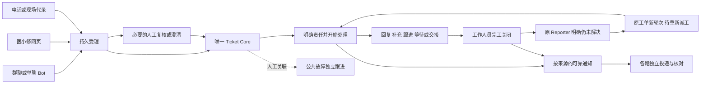

# PC 管理端人工业务接入计划

可以接入。正式 React 管理端已经有同源认证、真实看板／列表和安全详情基础；完整人工闭环需要先补齐部分后端命令和查询，再按依赖接入页面。本计划覆盖完整人工业务，用户已逐项回答 Q1–Q13 并确认共同理解。

这是实施路线与任务入口。规划／to-tickets 阶段的发布快照为所有新任务 `NOT_STARTED`，当时确认计划不授权业务实现、真实库迁移、部署、外发、full/certify 或 Gate 推进。

2026-10-07 用户随后授权 implement-spec 实施全部43票，当前进入本地实施与隔离验证。T01 已完成文档共同基线；其他票按 GitHub 当前原生依赖推进。当前授权与逐票实际记录见[实施记录](execution.md)，已发布能力、本地来源群增量、版本／身份和共同约束见[执行基线](execution-baseline.md)。上述规划历史保留；详细新 HTTP／Schema 由所属票同步定稿，不由 T01 预造全部合同。部署、真实依赖／外发、full/certify 和 Gate 边界保持。

2026-10-13 T10原七项已父独立核验并安全快进70ceb31d，[#65完成并读回](https://github.com/peterkis/Fault-Reporting-WeCom-Assistant/issues/65#issuecomment-6131558408)，真实被测69d5619e祖先保留；等待、恢复和独立合法取消的合同、当前授权、真实HTTP／生产制品浏览器、回滚、输入恢复及自有清理见[本票记录](execution/t10.md)。同一被测对象严格0／0／0、业务及兼容41 PASS；适用工具外层20 PASS／native0，原汇总器FAIL及5d保全限制保留。WBINT-02／A02所属T02、T04–T10八票均已本地交付、原生CLOSED/completed，来源工作包本地完成；当前27／43 CLOSED、16 OPEN，下一连续整票T12。默认关闭，全部43票及最终审查／工作树清理继续推进；本地交付不授予发布、现场或业务Gate。

2026-10-13 T12 原七项经父独立核对，82729c90由独立合并代理安全快进，[#67完成并读回](https://github.com/peterkis/Fault-Reporting-WeCom-Assistant/issues/67#issuecomment-6137509105)。d279本票21入口／36 PASS及关联前六入口21 PASS保留原被测身份；c9受影响10 PASS与build／strict／artifact原生0／0／0、适用工具20 PASS及独立retired1 PASS已核对，111／113扫描失败、118缺依赖setup FAIL与全部旧RED／NOT_RUN保持。最终纯文档两轴无新增问题、归档原件和精确自有停机已核验。当前 **28／43 CLOSED、15 OPEN**，见[逐项执行记录](execution/t12.md)。WBINT-03／A03已完成T11／T12切片，仍待T13；下一连续整票T13，其唯一原生阻塞#62已完成，#67仅为运行排程前序。默认关闭，全43最终审查和工作树清理继续待完成。

2026-10-13 T13 原七项已父验收，69afe5c1由独立合并代理安全快进，[#68完成并读回](https://github.com/peterkis/Fault-Reporting-WeCom-Assistant/issues/68#issuecomment-6140905877)。真实被测c6ec52保留040严格／build／artifact原生0、042本票17 PASS、相关五文件71项经两窗口通过和044工具外层27 PASS；原043超时FAIL、045字节比较误判及启动观察器整体exit1均保留。两轴源码及最终文档无未解决行动项，原件与精确自有清理已核。当前 **29／43 CLOSED、14 OPEN**，见[接单与交接链执行记录](execution/t13.md)。WBINT-03／A03所属T11–T13均本地交付；下一连续整票T30／#85，其唯一原生#83已完成。默认关闭，全43最终审查和工作树清理仍待。

2026-10-13 T30 原七项经父验收，13872854由独立合并代理安全快进，[#85完成并读回](https://github.com/peterkis/Fault-Reporting-WeCom-Assistant/issues/85#issuecomment-6144089454)。真实被测b44cdc保留039严格／build／artifact原生0及040单轮9文件14 PASS；029相关12 PASS仍属61f1，不改绑。两轴源码修补和最终四MD复核收口，1495源码／1921制品、冻结原件及精确自有清理均核实，原FAIL／NOT_REACHED／CONNECT UNKNOWN保留。当前 **30／43 CLOSED、13 OPEN**，见[内部处置与原命令恢复记录](execution/t30.md)。WBINT-10／A10已完成T30，T29／T31仍待；#86唯一原生#85已completed，下一连续整票T31按独立人工安全摘要、预览确认、仅定向有效未暂停个人的既定规则推进。默认关闭，全43最终审查与工作树清理继续待完成。

## 快速导航

| 阅读目的 | 文档 |
| --- | --- |
| 页面能接什么、还缺什么、对应 REST 在哪里 | [能力与接口映射](capability-map.md) |
| 按顺序领取任务、看依赖与交付要求 | [实施任务](implementation-plan.md) |
| 领取已发布的43票、查看实际原生阻塞关系 | [GitHub任务清单](tickets.md)：#56–#98，逐票执行前重读GitHub |
| 找本轮授权、基线及已核对的共同约束 | [实施记录](execution.md)／[执行基线](execution-baseline.md) |
| 验证业务、权限、并发、通知与浏览器行为 | [验收矩阵](acceptance-matrix.md) |
| 查找目前实际挂载的全部 HTTP 接口 | [docs/api](../../docs/api/README.md)／[路径索引](../../docs/api/endpoint-index.md) |
| 本次已决定的交接、退回及跟进规则 | [ADR-0031](../../adr/0031_human_workbench_collaboration_policy.md) |
| 统一业务词汇 | [CONTEXT.md](../../CONTEXT.md) |

## 基线和事实来源

规划时核对基点为上述 main HEAD 加当时工作区；当时来源群名称为尚未提交／发布的本地后继增量。[本地验证记录](../../evidence/workbench-source-group-names-local.md) 与[独立任务](../../tasks/workbench-source-group-names.md)保留该次实际状态。实施输入现已提交为本地集成 `516b4dce808981bdbcc449a850a1fdeaa2960cfb`，包含该增量，但未 push／部署／启用；不能归入 `3cf70794…` 的已发布能力，不重复开发或把037插入固定历史清单。实际对象见[执行基线](execution-baseline.md)。

按 [AGENTS.md](../../AGENTS.md)、[README](../../README.md)、[架构基线](../../docs/architecture_baseline_status.md)和 Accepted ADR 执行；目标与旧运行合同不一致时，先同步合同／相关基线，再实现和验证。领域设计整体的 PROPOSED 状态、合成原型或旧管理端按钮均不证明新 React 已接入。修改既有 P2 语义前必须读 [Conversation Center 变更前置要求](../../docs/domain-modeling/conversation-context-reference.md)及其指向文档。

继续沿用 [ADR-0023](../../adr/0023_origin_based_notification_routing.md)、[ADR-0024](../../adr/0024_staff_completion_and_takeover.md)、[ADR-0029](../../adr/0029_admin_workbench_frontend_boundaries.md)、[ADR-0030](../../adr/0030_admin_confirmed_source_group_names.md)。当前技术栈、600px 详情面板／整页能力、URL 导航和旧入口保留；不重做 UI 壳。

## 已确认的设计树

| 分支 | 本次确定的规则 |
| --- | --- |
| 范围 | 完整人工工作台，纳入必要后端补齐；每批同时交付合同、服务端、页面及验证 |
| 人工处理 | “我来处理”原子承接并开始；保留“先接单，稍后处理”；复核不确定材料先澄清，不强制建故障单 |
| 责任 | Ticket／Conversation 两份责任；默认同时承接明确关联会话，可保留原沟通人；多会话明确选择 |
| 跨团队 | 获权可见且具备业务操作权限的工单可跨团队接管；处理人和有效处理组一起交接，不新增全院读取权 |
| 完工／重开 | 内部过程与对外结果分开；工作人员完工关闭；原 Reporter 的明确未解决反馈重开原 Ticket、新轮次、重新派工 |
| 撤派／退回 | 未开始由调度／ADMIN 撤派；已开始由当前处理人或获权调度／ADMIN 停止退回，必填原因及未完成说明；默认保留沟通人，保留本轮历史 |
| 草稿 | 当前账号、浏览器和事项可恢复，最长 24 小时；恢复前验权，成功／丢弃／退出／失权清理；具体安全存储在 WBINT-01 定稿 |
| 已读／待跟进 | 本人实际看到才推进个人已读；团队补充待跟进须明确响应／处置，旧动作不清除新补充 |
| 预约 | 共享下一次行动时间；现有处理／沟通责任人及获权调度／ADMIN 维护，交接保留、结束清理留历史、重开重新安排 |
| 声音 | 初始静音，主动开启；获权团队新报修及与本人有关的新补充／重开／跟进到期；跨标签去重，重连不补响历史 |
| 通知 | 每轮首次明确责任和完工按原始来源路由；同轮交接／退回不重复已有里程碑通知，各路独立 Delivery |
| 公共故障 | 人工确认与独立生命周期；补负责人转交、内部处置记录、显式发布安全进展，沿用自身权限和订阅 |
| 体验 | 团队／与我有关、看板／列表、来源群、集中会话、通知异常、共享跟进、SSE、协作活动、搜索、合法拖动及必要设置 |

完整业务链：

明确报修先受理、先最小建单，AI 不参与受理前置；复核可与最小 Ticket 同时存在。不会把群成员同主题、时间接近或同名视为自动合并依据。

## 交付顺序

| 批次 | 任务 | 可独立检验的结果 |
| --- | --- | --- |
| A 合同与基础 | WBINT-00、01 | 目标／现状差异冻结，命令上下文、错误与草稿恢复基础可用 |
| B 人工工单 | WBINT-02、03 | 一步处理、双责任、跨团队交接、撤派／退回、完工关闭及完整责任链 |
| C 受理与本人反馈 | WBINT-04、05、06 | 复核到处理、工作人员代录、原 Reporter 未解决重开；已有材料可安全查看 |
| D 沟通与通知／公共故障 | WBINT-07、08、09、10、11 | 集中会话、按来源独立通知、公共故障完整人工跟进、获权异常处理 |
| E 实时与检索 | WBINT-12、13、14、15 | 个人未读／关注、团队跟进、预约、协作提示与声音、全量授权搜索、合法拖动和设置 |
| F 整体隔离验收 | WBINT-16 | 真 HTTP＋隔离 PG＋生产前端 bundle 的人工闭环证据及清理记录 |

每个任务可再按风险拆为小 PR，依赖未满足的动作保持不可用。A 完成后，现有会话与 Incident 读取接入可以与工单后端工作独立推进；通知闭环必须等待对应事件／轮次／身份合同，不提前接模拟成功。WEB02 对应 A/B，WEB03 对应 C，WEB04 对应 E 的实时／协作，WEB05 对应 D 等独立工作区；不重新解释 WEB05 为桌面壳。

## 开发、验证与发布边界

- Unified Ticket Core 是唯一编号、状态、责任和事件事实源，继续经既有 Port／事务访问；不新建第二套 Ticket、不直接共享库写集成。
- App/API/SSE 1 进程、Worker 1 进程、Gateway 单活；复用现有 PG／池，池总量建议不超过 8，SSE 默认上限 32，AI／通信／集成 concurrency 各为 1。
- 所有新增持久功能开关默认 false；具体名称、配置入口和依赖关系在合同任务中登记。关闭入口／投影能力后，不撤销已提交事实、不删除 Outbox；排空或停止发送按既有安全运行方案执行。
- 每任务带输入／输出、Schema、数据库或“无数据库变更”、权限与隐私、资源上限、开关、测试、Evidence、关闭／回滚、Backlog 状态。[验收矩阵](acceptance-matrix.md)规定对应风险。
- 新后端生产源码为 strict `.mts`／ESM，运行时导入保留 `.mjs`。普通 PR 使用活动 selection，严格类型、一次最终构建、相关测试、制品和自有资源清理；full、current certify、historical certify 分别按[迁移入口](../typescript-migration/README.md)独立执行与授权。
- 每次实施先重新确认 HEAD、HTTPS remote、工作区差异及写入范围，保留当前来源群增量、用户修改、附件目录和旧 Evidence。规划确认本身未授权 commit、push、merge 或分支清理；本轮用户追加授权的本地提交／集成范围见[实施记录](execution.md)，push及发布边界不由规划确认推导。

当前最后完成 Gate 仍为 P2-G1；P2-G2-LIVE／P2-008、AI Shadow／Copilot／OCR／Auto、医院内网新 Source、P3、生产和临床启用保持原边界。知识库、未定义 SLA／工作时间规则、Tauri 与桌面升级不是本计划首版交付。资料附件的受控人工读取是独立前置任务，不升级为 AI／媒体 Gate 通过。

## 执行入口与停止条件

规划阶段要求获授权后先执行 WBINT-00，再执行 WBINT-01；不得直接以原型事件或旧接口串联实现完工。当前 T01 共同基线已完成文档核对，来源群增量已纳入本地输入；逐票继续按真实依赖和自己的详细合同交付，不重复开发或直接迁移真实库。

合同、权限、合法目标组、原始来源或本人绑定不能证明时，停在受影响的动作，显示明确不可用／待核实并保留已记录受理。缺后端时交付前置任务，不能把计划 URL 写进已实现 API 索引或把合成验证记为现场证明。

## 本次计划文档核验

2026-10-07 检查13份涉及的计划、术语、决策与导航Markdown：114个本地链接有效，17项任务都有详情与验收组，依赖图无环，代码围栏和行末空白检查通过。用户原有AGENTS／医小修UI文档及冻结回调证据的SHA-256保持不变。此项仅是文档核验，业务实现／测试／迁移／部署／现场验证均未在本轮执行。
