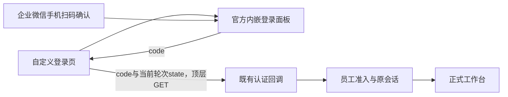

# 个性化内嵌扫码登录技术评估

状态：EVALUATION_ONLY / FEASIBLE_WITH_OFFICIAL_EMBEDDED_PANEL / IMPLEMENTATION_NOT_STARTED。评估日期：2026-10-29（Asia/Shanghai）。

用户希望主界面展示自定义内容和企业微信二维码，避免整页显示官方登录网站。本轮只评估：未修改认证、前端或桌面源码，未安装SDK、构建、部署、读取现场凭据、访问企业微信管理后台或实际扫码。此前未提交工作保持原位。

## 1. 结论与推荐

推荐采用 **同一业务HTTPS域名下的独立自定义登录页 + 企业微信官方内嵌登录面板 + 现有后端认证回调**。官方当前API为 `@wecom/jssdk` 的 `ww.createWWLoginPanel`，支持创建iframe登录面板；`redirect_type: callback` 能让父业务页面接收授权code并自行处理跳转。[官方面板API](https://developer.work.weixin.qq.com/document/path/98478)

这是对登录呈现与入口装配的中等范围改造，可以沿用现有企业微信应用、员工准入、内部角色、会话和CSRF合同；按此推荐方案，预计无需数据库迁移或第二套身份系统。是否可直接投产须以当前Electron容器及真实企业微信验证结果为准，文档可行不等于已完成兼容验证。

| 方案 | 定制范围与成本 | 判断 |
| --- | --- | --- |
| 当前官方整页跳转 | 现有实现成熟，登录页主体由官方控制 | 保留为兼容/故障回退路径 |
| 自有页面嵌入官方面板 | 外层页面可自定义，官方区域保留其交互；复用当前身份交换 | 最符合本次需求，推荐 |
| 自行生成二维码、手机授权PC、PC轮询完成登录 | 视觉与交互控制更大，需要新的跨设备授权、PC秘密绑定及确认/轮询协议 | 本次目标没有必要引入；不可把成员/H5回调直接当作PC会话 |

## 2. 当前实现核对

- [认证入口](../../app/server/src/p2-016-workbench-wecom-auth.mts)：`GET /workbench/desktop` 对有效员工会话303至 `/workbench/app/`，未认证时生成一次性intent并302至官方 `https://login.work.weixin.qq.com/wwlogin/sso/login`。当前明确使用 `login_type=CorpApp`，传企业CorpID及AgentID。
- 同一模块的 `begin` 生成带 `desktop.` 用途前缀的随机state和独立浏览器绑定；数据库保存两者哈希，intent寿命为5分钟，绑定Cookie为HttpOnly/Secure/SameSite=Lax。`complete` 原子消费未过期state并校验浏览器绑定，再向企业微信交换身份、匹配approved内部员工，建立原会话及CSRF Cookie，最后303到工作台。
- [桌面刷新策略](../../app/pc-admin/desktop/policy.mts)当前只从固定 `/workbench/desktop` 的主页面302响应和合法intent Cookie寿命安排更新；300秒intent提前60秒更新。[主进程](../../app/pc-admin/desktop/main.mts)在主frame回调开始时停止该定时器，聚焦、恢复和解锁时检查等待时间。
- [公共HTTP头](../../app/server/src/p2-006-workbench-http.mts)有严格 `script-src 'self'`、`default-src 'self'`、`frame-ancestors 'none'` 与 `X-Frame-Options: DENY`。跨站iframe未显式允许，直接添加标签不足以接入。
- [桌面preload](../../app/pc-admin/desktop/preload.cts)只给同源 `/workbench/app` 主frame暴露业务窄桥；登录页、官方iframe保持该边界。桌面使用同一 `persist:workbench` session，并拒绝普通网页权限请求。

## 3. 能定制到什么程度

| 内容 | 支持范围 |
| --- | --- |
| 页面背景、品牌Logo、说明、公共帮助、左右布局、加载/错误提示 | 自有页面可以完整设计，沿现有灰阶规范 |
| 官方面板大小 | 公开参数 `panel_size=middle` 为480×416，`small` 为320×380 |
| 官方面板内部文字、二维码周围布局及任意CSS | 当前官方FAQ明确不支持任意自定义组件内部样式；不以裁切、抓取图片或DOM注入作为稳定方案 |
| 页面内处理成功/失败 | 公开 `onLoginSuccess`、`onLoginFail`；可由父页接续原认证流程 |
| 外层精确显示“已扫码、手机待确认、二维码已过期” | 当前公开接口没有相应细分事件，不能承诺完整同步 |

尺寸及回调见[面板API](https://developer.work.weixin.qq.com/document/path/98478)，内部样式限制见[Web登录组件FAQ第4项](https://developer.work.weixin.qq.com/document/path/98174)。官方包2.4.4类型还存在light/dark/auto配色选项，但当前面板网页参数表未列出，若采用须锁版本并实测，不能据此承诺任意换肤。

当前应使用新面板API；旧文章中的 `WwLogin`、旧 `wwLogin.js` 及其样式参数属于另一套合同。不要把业务辅助函数名 `createWWLogin` 当作本次官方API。SDK在桌面系统浏览器中初始化该面板无需先调用 `ww.register` 或 `ww.checkJsApi`。[官方特别说明](https://developer.work.weixin.qq.com/document/path/98478)、[当前迁移建议](https://developer.work.weixin.qq.com/document/path/98174)

## 4. 推荐登录链路

1. 桌面打开固定同源登录入口。服务端按原合同创建登录intent、设置绑定Cookie，向页面提供本轮公开参数与state/到期信息；Secret、access_token和内部准入映射始终留在服务器。
2. 独立公开登录页调用官方面板，显式设置 `login_type=CorpApp`、正确CorpID/AgentID、既有同源 `redirect_uri`、本轮state和 `redirect_type=callback`。
3. `onLoginSuccess` 的公开返回只有 `{code}`，没有state。父页使用初始化本轮保存的服务器state，将code/state提交到既有 `/workbench/callback` 的顶层GET导航。SDK回调表示取得授权码，员工能否登录仍由现有后端判断。
4. 现有回调继续验证有效期、一次性消费、Cookie与浏览器绑定，并交换身份、校验准入、建立原会话和清洁回跳。

上述为待实施衔接方案。官方callback模式要求业务页面域名与redirect_uri域名一致；当前业务域与既有回调同源，适合这一布局。保持当前CorpApp身份，自建/代开发应用均适用；ServiceApp则是第三方登录授权SuiteID的另一种模式，不因服务商开发身份而自动切换。[面板参数/成功返回](https://developer.work.weixin.qq.com/document/path/98478)、[FAQ第5项与身份配置](https://developer.work.weixin.qq.com/document/path/98174)

推荐父页面顶层GET，避免让业务回调停留在官方iframe内。现有Lax Cookie对跨站顶层安全方法导航与iframe导航的待遇不同，iframe回调还会受到本系统禁止被嵌入的响应头影响。`frame-src`控制本页能嵌入哪些子页，`frame-ancestors`控制本页能被谁嵌入；允许官方子面板无需取消业务页的后者保护。[MDN SameSite说明](https://developer.mozilla.org/en-US/docs/Web/HTTP/Reference/Headers/Set-Cookie#samesitesamesite-value)

## 5. 需要改动的接缝

| 部位 | 建议改动 | 保留边界 |
| --- | --- | --- |
| 后端认证入口 | 分离intent创建与呈现，支持自定义登录HTML/公开参数，继续原回调；保留显式标准登录回退 | 一次性state、原绑定Cookie、TTL、准入、角色、原会话 |
| 登录页及构建 | 新增独立公开登录壳与专用JS/CSS，纳入维护构建和制品清单；官方SDK锁定版本 | 业务SPA及其资源继续鉴权；登录页不加载业务bootstrap和私有数据 |
| CSP | 仅登录壳按实际资源图允许官方登录frame；SDK可评估打包为同源资源 | 维持业务页策略、禁Node、contextIsolation、sandbox与webSecurity |
| 桌面宿主 | 适配新登录文档/响应、二维码刷新及frame导航；保留主页面与子frame分别校验 | 固定同源回调、登录页和第三方iframe无业务IPC，窗口/退出保护不变 |
| 验证与回退 | 编译认证测试、公开资源/CSP、真实Electron及真实扫码；保留旧登录入口和回退包 | 不扩展发送、Ticket Core、H5身份或其他Gate |

当前 `will-navigate` 主要覆盖主frame；嵌入后应分别处理frame导航及重定向，不能仅把既有顶层允许列表照搬为所有iframe规则。Electron45提供 `will-frame-navigate` 与frame信息，可按实际SDK使用的来源收敛策略；本次没有验证该装配。[Electron45官方源码文档](https://github.com/electron/electron/blob/v45.0.0/docs/api/web-contents.md#event-will-frame-navigate)

目前Electron仅给业务SPA主frame窄桥，所以建议独立同源登录路径，避免为扫码页面开放业务IPC。实际桌面版本继续由受信任标题栏显示。当前业务静态资源需要认证，新增登录页应有自己的公开资产白名单，不能整体开放 `/workbench/app/assets` 来解决加载问题。

## 6. 长等待与刷新必须同步改造

现有本机0.1.7的刷新策略明确要求 `/workbench/desktop` 返回302。如果改成200的自定义登录壳，旧定时器不会自动接管，因此本轮不能只替换HTML。应明确唯一刷新责任方，使二维码面板、本轮state、Cookie及到期时间同步更新；保留休眠/解锁/断网恢复后的到期检查。

公开面板对象只有 `el` 与 `unmount()`，没有已文档化的 `refresh()` 或扫码/确认/二维码到期事件。需要主动重启时，可卸载后重新初始化，并按服务端intent合同决定是否签发新轮次。授权code的5分钟寿命不能当作二维码图像本身的固定寿命。[公开API返回值](https://developer.work.weixin.qq.com/document/path/98478)、[code合同](https://developer.work.weixin.qq.com/document/path/98177)

应对旧轮次和重复回调加代际约束，只允许当前有效登录实例发起一次最终回跳；回调开始后停止刷新。长时间未扫、扫码确认跨刷新边界、迟到旧code、重启面板后旧回调等必须单列测试，防止再次出现需要扫码两次的问题。

## 7. Electron与快速登录的验证边界

官方描述的主要环境是桌面系统浏览器，没有明确保证本项目Electron45容器。扫码展示、回跳、session Cookie及第三方Cookie限制需要实机验证；不预先假定所有扫码流程依赖或完全不依赖第三方Cookie。[官方适用环境与FAQ](https://developer.work.weixin.qq.com/document/path/98174)

桌面企业微信“快速登录”与手机二维码扫码是两种能力。官方对Chrome/Edge142+快速登录列出较新SDK及本地网络访问权限要求；本项目当前拒绝网页权限，不能据二维码方案自动放开该权限。建议首轮只验收用户要求的扫码，快速登录另行评估；不能为了其成功关闭浏览器或Electron安全检查。[官方142+说明](https://developer.work.weixin.qq.com/document/60094)

## 8. 建议后续顺序与判定

先做最小集成验证，再确定最终视觉并实施正式改造。验证应使用同域名登录壳、当前CorpApp与官方面板，分别确认：

- 正常二维码、手机同意/拒绝、员工无权限、Provider错误及网络恢复；只有真实后端建立会话后才进入工作台。
- callback父页顶层GET带齐当前state和Cookie；重复code、旧轮次、过期state继续被拒绝。
- 等待超过5分钟、休眠/解锁、断网后恢复、扫码确认跨刷新；整个过程不要求用户手动重连或再次扫码来修复过期绑定。
- iframe/CSP、SDK消息来源、导航允许列表、当前session分区；新登录页及iframe没有业务桥，业务资产权限不变。
- 退出后进入自定义扫码页，401/403/503及草稿/UNKNOWN仍保留原区分；回退到原官方登录方式可用。

本次结论为 **官方能力满足目标，推荐方案与既有认证结构可衔接，当前容器兼容及真实扫码仍为NOT_RUN**。下一阶段应安排服务端/登录页改造和桌面适配验证，推荐配套升级桌面宿主以明确新响应、刷新和子frame边界。若希望只发布网页，需先证明页面独立负责刷新、既有宿主导航及过期回调恢复均可完整覆盖；当前302模式的测试结果不覆盖这一变更。不推进任何业务Gate。

## 9. 资料与证据

主要资料于2026-10-29核查：[官方Web登录组件](https://developer.work.weixin.qq.com/document/path/98174)、[官方面板API](https://developer.work.weixin.qq.com/document/path/98478)、[官方SDK入门](https://developer.work.weixin.qq.com/document/path/96914)、[代开发登录配置](https://developer.work.weixin.qq.com/document/path/98173)、[官方SDK2.4.4发布包](https://registry.npmjs.org/@wecom/jssdk/-/jssdk-2.4.4.tgz)、[Electron45文档](https://github.com/electron/electron/blob/v45.0.0/docs/api/web-contents.md)、[MDN Cookie](https://developer.mozilla.org/en-US/docs/Web/HTTP/Reference/Headers/Set-Cookie)。

研究原件 `.local/electron/embedded-login-evaluation-20261029/official-wecom-findings.md` 保留参数/类型、FAQ定位、版本差异、包哈希及限制。官方npm仓库和推测版本CDN地址的404未被当作可用接入来源；检索到的非官方转载不替代主要结论。示例、推理及未来验证项均未被称为已实现或已测试。
